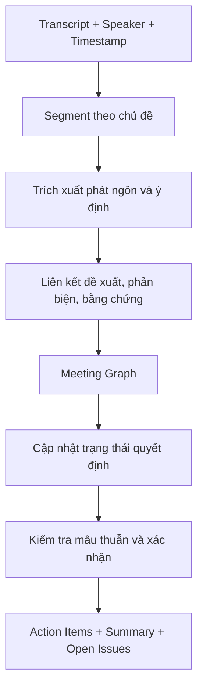

# Mission 1 — TRÍ TUỆ CUỘC HỌP (Meeting Intelligence Assistant)

## 1. Mô Tả Đề Bài & Thách Thức Nghiên Cứu

Doanh nghiệp cần một sản phẩm sử dụng AI để biến nội dung cuộc họp thành dữ liệu có cấu trúc có thể tiếp tục sử dụng cho công việc, quy trình và kho tri thức.

Trong một cuộc họp thường xuyên xuất hiện: **Quyết định**, **Công việc cần làm**, **Vướng mắc/phản biện**, **Yêu cầu/phản hồi**, **Vấn đề chưa chốt** và **Tri thức mới**.

Thách thức không phải chỉ là tóm tắt nội dung đơn thuần, mà là **hiểu đúng diễn biến cuộc họp** và xác định chính xác **thông tin nào thực sự có giá trị sau khi cuộc họp kết thúc**:
* **Chuyển đổi quyết định (Temporal Shift)**: Đầu cuộc họp đề xuất phương án A nhưng cuối cuộc họp chốt phương án B ➔ Hệ thống phải hiểu B mới là quyết định cuối cùng, A bị thay thế (`SUPERSEDED`).
* **Ngôn ngữ hội thoại tự nhiên (Conversational Sparsity)**: Đứt quãng trong giao tiếp, câu nói khuyết chủ/vị ngữ, từ đệm, nói đùa xen lẫn thảo luận nghiêm túc.
* **Nguy cơ ảo giác (Hallucination)**: Các mô hình tóm tắt truyền thống thường tự suy diễn người nhận việc hoặc bịa ra deadline nếu lời nói không nêu cụ thể.
* **Duy trì ngữ cảnh xuyên suốt (Cross-chunk Context)**: Cuộc họp kéo dài hàng giờ với nhiều chủ đề chuyển dịch liên tục.

---

## 2. Mục Tiêu Cốt Lõi: Từ Phát Ngôn Đến Hành Động Có Thể Thực Thi

Hệ thống chuyển dịch từ mô hình *"Tóm tắt thụ động"* sang **"Hiểu ngữ nghĩa & Trích xuất dữ liệu có cấu trúc (Meeting Understanding ➔ Actionable Structured Information)"**:
1. **Hành động cần thực hiện (Action Items)**: Rõ ràng công việc, người chịu trách nhiệm (`assignee`), thời hạn (`deadline`) và đối tượng tác động.
2. **Quyết định chính thức (Decisions)**: Nhận diện sự đồng thuận, trạng thái hiệu lực (`is_final_active`) và truy vết phương án cũ bị thay thế.
3. **Liên kết bằng chứng gốc (Evidence Grounding)**: Mọi thông tin đều gắn với trích dẫn nguyên văn (`quote_text`, `speaker`, `timestamp`) để đối chiếu.

---

## 3. Kiến Trúc 5 Trụ Cột Kỹ Thuật

Giải pháp được cấu thành từ 5 trụ cột kỹ thuật tương hỗ:
* • **Semantic Intent Schema**: Định nghĩa intent, tham số, người thực hiện, deadline và quy tắc Null-Safety chống ảo giác.
* • **Temporal Decision Tracking**: Mô hình Event Sourcing theo dõi đề xuất, phản biện, quyết định thay thế (`SUPERSEDES`).
* • **Context-aware Chunking**: Phân đoạn theo chủ đề (Topic Segmentation) kết hợp Context State Accumulation.
* • **Meeting Graph Construction**: Xây dựng đồ thị tri thức lấy bằng chứng làm trọng tâm (Evidence-Centered).
* • **Graph Retrieval**: Truy vấn chuỗi nhân quả qua Graph Traversal để trả lời: *"Vì sao có nhiệm vụ này, ai yêu cầu và bằng chứng ở phút nào?"*.

---

## 4. Graph Engineering Giải Quyết Vấn Đề Nào Trong Dự Án?
Ví dụ một cuộc họp có diễn biến:
•	09:05 — An đề xuất sử dụng phương án A.
•	09:12 — Bình phản biện rằng phương án A vượt ngân sách.
•	09:18 — Chi đề xuất phương án B.
•	09:25 — An đồng ý chuyển sang B.
•	09:30 — Trưởng nhóm chốt phương án B và giao An hoàn thành trước thứ Sáu.
Nếu chỉ chia transcript thành các đoạn rồi tóm tắt độc lập, hệ thống có thể bỏ lỡ việc quyết định đã thay đổi từ A sang B.
Với graph, bạn biểu diễn được chuỗi quan hệ giữa phát ngôn, phản biện, phương án, quyết định và nhiệm vụ.
Phát ngôn 1
An đề xuất phương án A
bị phản biện bởi
Phát ngôn 2
Bình nêu vấn đề ngân sách
dẫn đến xem xét
Quyết định cuối cùng
Chọn phương án B · thay thế A
tạo ra
Action Item
An hoàn thành trước thứ Sáu
Graph không tự đảm bảo AI hiểu đúng. Nó cung cấp cấu trúc để lưu bằng chứng, liên kết các phát ngôn và cập nhật trạng thái quyết định một cách nhất quán.
2. Bạn nên thiết kế graph như thế nào?
Mình đề xuất xây dựng Meeting Knowledge Graph kết hợp Temporal State Tracking — đồ thị tri thức cuộc họp có theo dõi sự thay đổi trạng thái theo thời gian.
Không nên chỉ tạo graph gồm Person → Task. Bạn cần biểu diễn được diễn biến thảo luận.
Các loại node nên có
Node	Thông tin lưu trữ
Meeting	Cuộc họp, thời gian, dự án
Utterance	Phát ngôn, người nói, timestamp, transcript gốc
Topic	Chủ đề và các đoạn hội thoại liên quan
Proposal / Argument	Đề xuất, lý do, phản biện, sự đồng tình
Decision	Quyết định, trạng thái, thời điểm chốt
ActionItem	Công việc, người phụ trách, deadline, trạng thái
Resource	Email, tài liệu, repository, đường dẫn liên quan
Các quan hệ quan trọng gồm:
•	Utterance → SUPPORTS / OPPOSES → Proposal
•	Utterance → RESPONDS_TO → Utterance
•	Utterance → BELONGS_TO → Topic
•	Decision → SELECTS → Proposal
•	Decision → SUPERSEDES → Decision
•	ActionItem → DERIVED_FROM → Decision
•	ActionItem → ASSIGNED_TO → Person
•	ActionItem → REFERENCES → Resource
Lưu ý: một phát ngôn có thể đồng thời phản biện đề xuất này và ủng hộ đề xuất khác. Vì vậy, quan hệ nên được xác định theo ngữ cảnh, không chỉ theo câu chữ.
3. Graph Memory có cần thiết không?
Có thể dùng graph như bộ nhớ diễn biến của cuộc họp, nhưng không nên nhầm nó với toàn bộ hệ thống.
Transcript Store
Lưu nội dung gốc, timestamp và người nói để truy vết bằng chứng.
Meeting Graph / Graph Memory
Lưu các chủ đề, phát ngôn quan trọng, đề xuất, phản biện, quyết định và công việc cùng các mối quan hệ.
Structured Action Store
Lưu action items ở dạng có cấu trúc để tìm kiếm, cập nhật trạng thái, giao việc và tích hợp với hệ thống doanh nghiệp.
LLM + Context Engine
Phân tích ngữ nghĩa, xác định phát ngôn liên quan và cập nhật trạng thái khi có thông tin mới.
4. Xử lý cuộc họp dài mà không mất ngữ cảnh
Đây là nơi Graph Engineering có thể tạo khác biệt rõ nhất trong đề tài của bạn.
Thay vì xử lý từng chunk độc lập, hãy thiết kế pipeline:

Mỗi chunk mới cần được đối chiếu với trạng thái đã tích lũy:
•	Chủ đề này đã được thảo luận trước đó chưa?
•	Phát ngôn mới đang bổ sung hay phản bác ý kiến cũ?
•	Quyết định trước đã được xác nhận, thay thế hay vẫn còn mở?
•	Công việc đã có người chịu trách nhiệm và deadline chưa?
Đặc biệt, không được coi phát ngôn mới nhất là quyết định cuối cùng chỉ vì nó xuất hiện sau cùng. Hệ thống cần phát hiện tín hiệu chốt quyết định, mức độ thẩm quyền của người nói, sự đồng thuận và các bằng chứng liên quan.
5. Công nghệ nên chọn cho phiên bản đầu tiên
Thành phần	Đề xuất
NLP / LLM	Trích xuất intent, arguments, entities và quan hệ
Embeddings	Tìm phát ngôn tương tự hoặc chủ đề đã xuất hiện
Graph database	Neo4j để lưu và truy vấn quan hệ
Structured storage	PostgreSQL để lưu action items và trạng thái
Orchestration	LangGraph để quản lý pipeline và state
Evaluation	Đo độ chính xác quyết định cuối cùng, action extraction, speaker/owner và truy xuất bằng chứng
Đây là kiến trúc đề xuất, không phải bắt buộc phải triển khai đủ tất cả. Với MVP, bạn có thể lưu graph trong PostgreSQL trước, rồi chuyển sang Neo4j khi truy vấn nhiều bước và quan hệ phức tạp trở thành nhu cầu thực tế.
6. Thứ tự ưu tiên mình khuyên bạn
1.	Semantic Intent Schema: định nghĩa intent, tham số, người thực hiện, đối tượng, deadline và điều kiện hoàn thành.
2.	Temporal Decision Tracking: theo dõi đề xuất, phản biện, quyết định được sửa đổi và trạng thái cuối.
3.	Context-aware Chunking: chia transcript theo chủ đề nhưng duy trì ngữ cảnh xuyên chunk.
4.	Meeting Graph Construction: xây dựng nodes, edges và liên kết bằng chứng.
5.	Graph Retrieval: truy vấn lại lịch sử thảo luận để giải thích vì sao một nhiệm vụ hoặc quyết định được tạo ra.
Đánh giá theo từng tầng để biết graph có thực sự giúp ích hay không: so sánh hệ thống chỉ dùng LLM với hệ thống có graph trên cùng một tập transcript.
Kết luận: Với đề tài này, Graph Engineering phù hợp nhất ở vai trò bộ máy quản lý ngữ cảnh, quan hệ và trạng thái quyết định của cuộc họp. Giá trị chính không nằm ở việc vẽ ra một đồ thị đẹp, mà ở việc biến cuộc hội thoại dài, có phản biện và thay đổi ý kiến thành các quyết định cùng công việc có thể truy vết, kiểm chứng và thực thi.
---

## 7. Bản Đồ Tài Liệu Kỹ Thuật Toàn Diện Của Dự Án

Toàn bộ giải pháp kiến trúc và nghiên cứu tham chiếu của dự án đã được chi tiết hóa theo thứ tự triển khai:

### A. Bộ tài liệu Thiết kế Kiến trúc Hệ thống (System Architecture):
1. [01-Semantic-Intent-Schema.md](file:///d:/GENTALENT/01-Semantic-Intent-Schema.md) — Đặc tả dữ liệu 3 lớp, Taxonomy 7 nhóm Intent và JSON Schema.
2. [02-Temporal-Decision-Tracking.md](file:///d:/GENTALENT/02-Temporal-Decision-Tracking.md) — Theo dõi sự thay đổi quyết định theo thời gian (`SUPERSEDES`) và Event Sourcing.
3. [03-Context-Aware-Chunking.md](file:///d:/GENTALENT/03-Context-Aware-Chunking.md) — Phân đoạn cuộc họp theo chủ đề & duy trì trạng thái ngữ cảnh tích lũy.
4. [04-Meeting-Graph-Construction.md](file:///d:/GENTALENT/04-Meeting-Graph-Construction.md) — Xây dựng đồ thị tri thức cuộc họp lấy bằng chứng làm trọng tâm (Evidence-Centered).
5. [05-Graph-Retrieval.md](file:///d:/GENTALENT/05-Graph-Retrieval.md) — Truy vấn đồ thị đa bước, Text-to-Cypher và Hybrid Subgraph RAG.
6. [06-LLM-Agentic-Pipeline-Design.md](file:///d:/GENTALENT/06-LLM-Agentic-Pipeline-Design.md) — Hướng dẫn kiến trúc triển khai đa tác nhân thực chiến với LLM API.

### B. Bộ tài liệu Nghiên cứu Tham chiếu (Literature Reviews):
* [Ref-Meeting-Decision-Tracker-MDT.md](file:///d:/GENTALENT/Ref-Meeting-Decision-Tracker-MDT.md) — Nghiên cứu tham chiếu về DUD & DUR (Tầng vi mô).
* [Ref-Microsoft-GraphRAG-Analysis.md](file:///d:/GENTALENT/Ref-Microsoft-GraphRAG-Analysis.md) — Nghiên cứu GraphRAG của Microsoft Research (Tầng vĩ mô & Global Search).
* [Ref-OpenAI-Structured-Outputs.md](file:///d:/GENTALENT/Ref-OpenAI-Structured-Outputs.md) — Phân tích kỹ thuật tính năng Structured Outputs của OpenAI.
