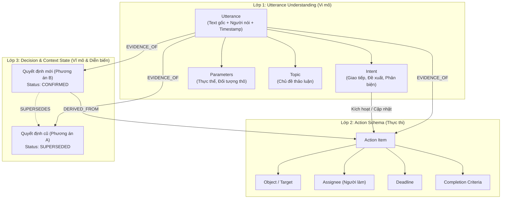

# Semantic Intent Schema & Kiến Trúc Hiểu Cuộc Họp (Meeting Intelligence)

Tài liệu này định nghĩa toàn diện lược đồ ý định ngữ nghĩa (**Semantic Intent Schema**), kiến trúc phân lớp xử lý (**3-Layer Architecture**), bộ danh mục ý định (**Intent Taxonomy**), cơ chế đồ thị tri thức (**Graph & Provenance Modeling**) và lộ trình triển khai MVP cho hệ thống Trợ lý Cuộc họp AI (Meeting Intelligence Assistant).

---

## 1. Khái Niệm Nền Tảng (Foundational Concepts)

Để biến transcript hội thoại phi cấu trúc thành dữ liệu thực thi, hệ thống được xây dựng dựa trên 5 khái niệm cốt lõi:

| Khái niệm | Ý nghĩa | Câu hỏi cần trả lời |
| :--- | :--- | :--- |
| **Intent** | Nhãn biểu thị mục đích giao tiếp hoặc hành động của phát ngôn | Người nói muốn làm gì? |
| **Training Phrases** | Các phát ngôn mẫu huấn luyện hoặc Few-shot prompts cho LLM | Nhận diện ý định qua các biểu đạt nào? |
| **Parameters** | Các trường thông tin có cấu trúc cần bóc tách từ phát ngôn | Những thông tin cụ thể nào cần lấy ra? |
| **Intent Matching** | So khớp phát ngôn với danh mục Intent kèm điểm tin cậy (*Confidence*) | Ý định nào phù hợp nhất trong ngữ cảnh này? |
| **Head & Supplemental Intent** | Phân biệt ý định khởi phát với ý định bổ trợ trong hội thoại đa lượt | Đây là ý định mới hay bổ sung cho ý định trước? |

### Phân cấp ngữ cảnh cuộc họp:
$$\text{Cuộc họp (Meeting)} \longrightarrow \text{Chủ đề (Topic)} \longrightarrow \text{Phát ngôn (Utterance)} \longrightarrow \text{Ý định (Intent)} \longrightarrow \text{Hành động (Action Item)}$$

---

## 2. Kiến Trúc Semantic Intent Schema 3 Lớp

Thay vì gom toàn bộ thông tin cuộc họp vào một trường `intent` phẳng (*flat intent*) gây nhập nhằng ngữ nghĩa, hệ thống phân tách schema thành 3 lớp chuyên biệt:



### Lớp 1 — Utterance Understanding (Hiểu từng phát ngôn)
* **Nhiệm vụ:** Phân tích ngữ nghĩa cục bộ của từng lượt phát ngôn.
* **Thành phần:** Người nói (*Speaker*), vai trò (*Role*), chủ đề (*Topic*), ý định giao tiếp (*Communicative Intent*), đề xuất, đồng thuận, phản đối và thông tin được đề cập.

### Lớp 2 — Action Schema (Chuẩn hóa công việc)
* **Nhiệm vụ:** Chuyển đổi nội dung được thỏa thuận thành nhiệm vụ cụ thể có thể tích hợp với các công cụ quản lý dự án (Jira, Trello, Asana).
* **Thành phần:** Hành động (*Action*), tham số chi tiết (*Parameters*), người phụ trách (*Assignee*), đối tượng (*Object*), hạn chót (*Deadline*), và tiêu chí nghiệm thu (*Completion Criteria*).

### Lớp 3 — Decision & Context State (Theo dõi diễn biến & trạng thái quyết định)
* **Nhiệm vụ:** Theo dõi dòng thời gian (*Temporal Tracking*) và sự tiến triển của các quyết định trong cuộc họp.
* **Thành phần:** Xác định đề xuất nào còn mở (*OPEN*), đề xuất nào bị bác bỏ (*REJECTED*), quyết định nào được thay thế (*SUPERSEDED*) và công việc nào bắt nguồn từ quyết định cuối cùng (*CONFIRMED*).

---

## 3. Các Trường Dữ Liệu Chi Tiết & Nguyên Tắc Thiết Kế

| Trường dữ liệu | Ý nghĩa | Kiểu dữ liệu | Ví dụ minh họa |
| :--- | :--- | :--- | :--- |
| `intent` | Loại ý định nhận diện | `enum` / `string` | `CREATE_TASK`, `PROPOSE_OPTION` |
| `parameters` | Tham số bổ sung bóc tách từ ngữ cảnh | `object` | `{"resource_type": "repository", "env": "staging"}` |
| `object` | Đối tượng tác động của hành động | `object` / `string` | `{"type": "repo", "name": "meeting-assistant"}` |
| `assignee` | Người chịu trách nhiệm thực hiện | `object` (Nullable) | `{"person_id": "usr_01", "name": "An"}` hoặc `null` |
| `deadline` | Thời hạn hoàn thành | `object` (Nullable) | `{"raw_text": "trước thứ Sáu", "normalized_date": null}` |
| `completion_criteria` | Tiêu chí nghiệm thu / Điều kiện hoàn thành | `array[string]` (Nullable) | `["Repo được tạo", "Cấp quyền truy cập cho nhóm"]` |
| `status` | Trạng thái hiện tại | `enum` | `PROPOSED`, `CONFIRMED`, `SUPERSEDED`, `DONE` |
| `evidence` | Bằng chứng đối chiếu trong transcript gốc | `array[Evidence]` | `[{"speaker": "Team Lead", "timestamp": "09:18", ...}]` |
| `confidence` | Độ tin cậy do mô hình ước lượng | `float (0.0 - 1.0)` | `0.94` |
| `relations` | Mối quan hệ với các phát ngôn / quyết định khác | `array[Relation]` | `[{"type": "SUPERSEDES", "target_id": "DEC-001"}]` |

> [!IMPORTANT]
> **Nguyên tắc thiết kế cốt lõi (Core Design Principles):**
> 1. **Null-Safety & Zero-Hallucination:** Các trường `assignee`, `deadline`, và `completion_criteria` **bắt buộc cho phép giá trị chưa xác định (`null`)**. Tuyệt đối không để LLM tự suy diễn hoặc bịa thông tin khi transcript chưa chốt rõ ràng.
> 2. **Bảo toàn Raw Text:** Deadline ban đầu phải lưu dạng `raw_text` (ví dụ: *"trước thứ Sáu"*), trường `normalized_date` để `null` cho tới khi có module phân giải thời gian dựa trên ngày họp thực tế (`meeting_date`).
> 3. **Bản chất của Confidence:** Điểm `confidence` là giá trị ước lượng của mô hình trích xuất, không phải xác suất thống kê tuyệt đối đã hiệu chuẩn.

---

## 4. Bộ Taxonomy Intent Cho Cuộc Họp (MVP)

Không nên định nghĩa hàng trăm intent phức tạp ngay từ đầu. Dưới đây là taxonomy 7 nhóm tối ưu cho giai đoạn MVP:

| Nhóm | Intent mẫu | Mục đích & Mô tả | Ví dụ thực tế |
| :--- | :--- | :--- | :--- |
| **Công việc** | `CREATE_TASK`<br>`UPDATE_TASK`<br>`ASSIGN_TASK` | Tạo mới, cập nhật hoặc phân công công việc cụ thể | *"Minh cập nhật lại tài liệu API nhé."* |
| **Đề xuất** | `PROPOSE_OPTION`<br>`REQUEST_CHANGE` | Đưa ra ý tưởng, giải pháp mới hoặc yêu cầu chỉnh sửa | *"Tôi đề xuất mình chuyển sang giải pháp B."* |
| **Lập luận** | `SUPPORT_PROPOSAL`<br>`OPPOSE_PROPOSAL` | Thể hiện sự đồng thuận hoặc phản biện, nêu rủi ro | *"Giải pháp A sẽ làm đội ngân sách lên gấp đôi."* |
| **Quyết định** | `CONFIRM_DECISION`<br>`REJECT_PROPOSAL`<br>`SUPERSEDE_DECISION` | Xác nhận chốt, bác bỏ hoặc thay thế một quyết định cũ | *"Chốt làm theo giải pháp B, bỏ phương án A."* |
| **Cam kết** | `ACCEPT_RESPONSIBILITY`<br>`SET_DEADLINE` | Tự nhận trách nhiệm hoặc cam kết mốc thời gian | *"Tôi sẽ chịu trách nhiệm phần tích hợp này."* |
| **Tra cứu** | `REQUEST_INFORMATION`<br>`REFERENCE_RESOURCE` | Đặt câu hỏi tìm hiểu hoặc dẫn chiếu tài liệu, link | *"Tài liệu này nằm ở đâu trong drive vậy?"* |
| **Thảo luận** | `DISCUSS_TOPIC`<br>`AGREE`<br>`DISAGREE` | Trao đổi chung, chưa trực tiếp hình thành công việc | *"Phần đó hiện tại vận hành khá ổn định."* |

> [!TIP]
> **Phân biệt then chốt giữa "Khả năng" và "Cam kết":**
> * Phát ngôn: *"Có thể tạo repository vào thứ Sáu"* $\longrightarrow$ Chỉ là thảo luận / khả năng (`PROPOSE_OPTION` / `DISCUSS_TOPIC`).
> * Phát ngôn: *"An sẽ tạo repository vào thứ Sáu"* $\longrightarrow$ Thể hiện sự cam kết rõ ràng (`ASSIGN_TASK` / `ACCEPT_RESPONSIBILITY`).
> Hệ thống cần phân tích vai trò người nói (*Speaker Authority*) và sự xác nhận tiếp nối trước khi chuyển thành Action Item chính thức.

---

## 5. Ví Dụ Dữ Liệu Thực Tế (Real-world Scenario & JSON)

### Diễn biến cuộc họp mẫu:
* **09:10 — An:** *"Tôi đề xuất dùng PostgreSQL."*
* **09:12 — Bình:** *"Tôi lo chi phí vận hành, nên dùng giải pháp B."*
* **09:18 — Trưởng nhóm:** *"Chốt giải pháp B. An tích hợp trước thứ Sáu và gửi link kiểm thử."*

### Cấu trúc Action Item chuẩn hóa (JSON Output):
```json
{
  "action_id": "ACT-001",
  "intent": "INTEGRATE_SOLUTION",
  "parameters": {
    "solution": "Solution B",
    "environment": "testing"
  },
  "object": {
    "type": "software_component",
    "name": "Solution B"
  },
  "assignee": {
    "person_id": "person_an",
    "name": "An",
    "source_utterance": "utterance_003"
  },
  "deadline": {
    "raw_text": "trước thứ Sáu",
    "normalized_date": null,
    "status": "NEEDS_DATE_RESOLUTION"
  },
  "completion_criteria": [
    "Solution B is integrated",
    "A testing link is provided"
  ],
  "status": "CONFIRMED",
  "evidence": [
    {
      "utterance_id": "utterance_003",
      "speaker": "Team Lead",
      "timestamp": "00:09:18",
      "text": "Chốt giải pháp B. An tích hợp trước thứ Sáu và gửi link kiểm thử."
    }
  ],
  "confidence": 0.94,
  "relations": [
    {
      "relation_type": "DERIVED_FROM",
      "target_node_id": "DEC-002",
      "target_type": "Decision"
    }
  ]
}
```

---

## 6. Kết Nối Semantic Intent Schema Với Graph Engineering & W3C PROV

Schema cung cấp cấu trúc dữ liệu tĩnh; **Graph Engineering** mang lại sức mạnh biểu diễn quan hệ động và ngữ cảnh tiến triển theo thời gian:

### Quy tắc bất biến & Truy vết nguồn gốc (Provenance Modeling)
1. **Không ghi đè lịch sử:** Khi trưởng nhóm chuyển từ phương án A sang B, hệ thống không xóa hay ghi đè phương án A. Thay vào đó, một node `Decision (B)` mới được tạo với cạnh `SUPERSEDES` trỏ tới `Decision (A)`.
2. **Liên kết bằng chứng:** Action Item trỏ tới `Decision (B)` qua cạnh `DERIVED_FROM`, đồng thời trỏ tới phát ngôn lúc 09:18 qua cạnh `EVIDENCE_OF`.
3. **Chuẩn hóa W3C PROV:**
   * **Entity (Thực thể):** Proposal, Decision, ActionItem, Document.
   * **Activity (Hoạt động):** Utterance, Discussion, Amendment.
   * **Agent (Tác nhân):** Người tham gia cuộc họp (Team Lead, Developer).
   *(Tham khảo chuẩn: [W3C PROV-DM](https://www.w3.org/ns/prov))*

---

## 7. Lộ Trình Triển Khai MVP & Tiêu Chí Đánh Giá

1. **Định nghĩa Schema (Code-first):**
   * Xây dựng Pydantic Models hoặc JSON Schema chuẩn trong Python, định nghĩa rõ các trường `Optional` / `Nullable` và `Enum`.
2. **Trích xuất bằng LLM (Structured Outputs):**
   * Prompt đầu vào bao gồm: transcript theo từng chunk, speaker metadata, timestamp và cửa sổ trạng thái tích lũy (*Accumulated Context State*).
   * Yêu cầu LLM trả về đúng schema định dạng JSON.
3. **Kiểm tra nghiệp vụ (Business Rules Validation):**
   * Xác thực người thực hiện, thời hạn, tiêu chí hoàn thành; chặn tuyệt đối hành vi tự suy diễn của LLM khi thiếu dữ liệu.
4. **Cập nhật trạng thái (State Machine):**
   * Phân luồng rõ: Đề xuất đang mở $\rightarrow$ Quyết định xác nhận $\rightarrow$ Quyết định bị thay thế $\rightarrow$ Công việc hoàn thành.
5. **Lưu trữ đồ thị (Graph Storage Evolution):**
   * **Giai đoạn MVP:** Dùng PostgreSQL (kết hợp các bảng quan hệ `nodes` và `edges` hoặc JSONB) để triển khai nhanh và dễ kiểm soát.
   * **Giai đoạn mở rộng:** Chuyển sang Neo4j khi cần thực hiện các truy vấn đồ thị phức tạp (*multi-hop graph traversal, path finding*).
6. **Bộ chỉ số đánh giá (Evaluation Metrics):**
   * **Intent Accuracy:** Tỷ lệ phân loại đúng ý định giao tiếp.
   * **Slot / Parameter Accuracy:** Độ chính xác khi bóc tách Assignee, Deadline, Object.
   * **Final Decision Accuracy:** Tỷ lệ nhận diện đúng quyết định cuối cùng (tránh nhận nhầm đề xuất ban đầu).
   * **Traceability Rate:** Tỷ lệ thông tin công việc truy xuất ngược lại được phát ngôn bằng chứng gốc (Mục tiêu $\ge 98\%$).