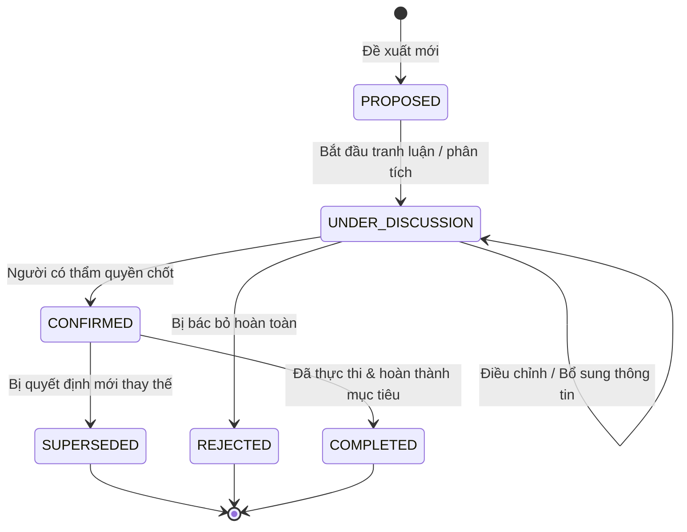
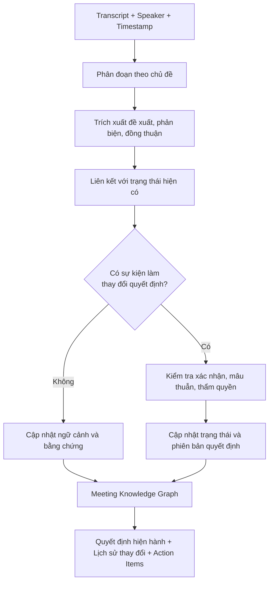

# Temporal Decision Tracking — Theo Dõi Diễn Biến Quyết Định Cuộc Họp

Tài liệu này định nghĩa cơ chế theo dõi sự hình thành, tranh luận và thay đổi của quyết định theo thời gian (**Temporal Decision Tracking**) phục vụ cho hệ thống Trợ lý Cuộc họp AI (Meeting Intelligence Assistant).

---

## 1. Tổng Quan & Bài Toán Đặt Ra

Trong các cuộc họp doanh nghiệp, một quyết định hiếm khi được đưa ra ngay lập tức mà luôn trải qua một quá trình tiến triển:
$$\text{Đề xuất ban đầu} \longrightarrow \text{Tranh luận / Phản biện} \longrightarrow \text{Điều chỉnh phương án} \longrightarrow \text{Chốt quyết định cuối cùng}$$

Nếu hệ thống AI chỉ tóm tắt tĩnh hoặc chỉ lấy phát ngôn sau cùng, nó sẽ gặp các rủi ro nghiêm trọng:
* **Hiểu nhầm phát ngôn cuối:** Một câu nói bâng quơ ở cuối buổi (*"Hay là mình thử phương án C?"*) có thể bị nhầm là quyết định chính thức dù chưa được ai đồng thuận.
* **Mất dấu lý do thay đổi (Provenance loss):** Không giải thích được vì sao phương án ban đầu (vốn rất được ủng hộ) lại bị hủy bỏ.
* **Bỏ sót nhiệm vụ phụ thuộc:** Khi quyết định thay đổi, các công việc đã giao theo quyết định cũ không được cập nhật hoặc hủy bỏ kịp thời.

> [!NOTE]
> **Cơ sở khoa học tham chiếu:** Cơ chế phát hiện và xử lý phát ngôn quyết định trong hệ thống được kế thừa và phát triển từ nghiên cứu [Meeting Decision Tracker (MDT)](file:///d:/GENTALENT/Ref-Meeting-Decision-Tracker-MDT.md) với khung làm việc 2 giai đoạn: Phát hiện (*DUD*) và Viết lại (*DUR*).

---

## 2. Temporal Decision Tracking Là Gì?

**Temporal Decision Tracking** là cơ chế theo dõi sự hình thành và thay đổi của quyết định theo dòng thời gian trong suốt cuộc họp.

Hệ thống không chỉ ghi nhận *"quyết định cuối cùng là gì"*, mà còn phải trả lời được:
1. Ban đầu nhóm đề xuất những phương án nào?
2. Ai phản đối, vì lý do gì?
3. Phương án nào được điều chỉnh sau phản biện?
4. Ai có thẩm quyền hoặc vai trò xác nhận quyết định?
5. Quyết định nào đang có hiệu lực, quyết định nào đã bị thay thế?
6. Công việc nào phát sinh từ quyết định cuối cùng?

---

## 3. Ví Dụ: Theo Dõi Diễn Biến Quyết Định

Giả sử cuộc họp thảo luận về lựa chọn cơ sở dữ liệu cho dự án:

| Thời điểm | Sự kiện | Phân loại | Nội dung phát ngôn & Hành động |
| :---: | :--- | :--- | :--- |
| **09:10** | **Sự kiện 1** | **Đề xuất (Proposal)** | **An đề xuất PostgreSQL:**<br>*"Tôi đề xuất dùng PostgreSQL vì hệ thống cần quản lý dữ liệu quan hệ."* |
| **09:12** | **Sự kiện 2** | **Phản biện (Objection)** | **Bình nêu lo ngại vận hành:**<br>*"Chi phí vận hành có thể cao. Chúng ta nên cân nhắc giải pháp B."* |
| **09:16** | **Sự kiện 3** | **Điều chỉnh (Refinement)** | **An đề xuất đánh giá lại:**<br>*"Vậy chúng ta so sánh chi phí và khả năng mở rộng trước khi chốt."* |
| **09:20** | **Sự kiện 4** | **Quyết định (Final Decision)** | **Trưởng nhóm chốt giải pháp B:**<br>*"Chốt giải pháp B. An tích hợp trước thứ Sáu và gửi link kiểm thử."* |

> [!IMPORTANT]
> **Nguyên tắc bảo toàn lịch sử:** Hệ thống **không được xóa** đề xuất PostgreSQL chỉ vì quyết định cuối cùng là Giải pháp B. Hệ thống phải lưu trọn vẹn chuỗi lịch sử, lý do thay đổi và bằng chứng xác nhận.

---

## 4. Mô Hình Dữ Liệu Theo Thời Gian (Temporal Data Model)

Hệ thống thiết kế 4 loại thực thể cốt lõi:

| Thực thể | Nội dung lưu trữ | Vai trò trong hệ thống |
| :--- | :--- | :--- |
| **`Proposal`** | Phương án, người đề xuất, thời điểm, nội dung chi tiết | Ghi nhận các phương án được đưa ra xem xét |
| **`Objection`** | Phản biện, người phản biện, lý do (chi phí, tiến độ, rủi ro) | Lưu vết tranh luận và nguyên nhân phương án bị đổi |
| **`Decision`** | Nội dung quyết định, trạng thái, thời điểm xác nhận, phiên bản | Đại diện cho kết luận chính thức |
| **`DecisionEvent`** | Sự kiện làm thay đổi trạng thái quyết định (Append-only) | Dòng lịch sử sự kiện phục vụ Event Sourcing |

### Các quan hệ then chốt trong Meeting Graph:
* `PROPOSES`: Phát ngôn đưa ra phương án.
* `OPPOSES`: Phản biện một phương án.
* `SUPPORTS`: Ủng hộ một phương án.
* `REFINES`: Điều chỉnh hoặc làm rõ phương án.
* `SELECTS`: Quyết định chọn phương án cụ thể.
* `SUPERSEDES`: Quyết định mới thay thế quyết định cũ.
* `EVIDENCED_BY`: Liên kết quyết định trực tiếp với phát ngôn làm bằng chứng.

---

## 5. Quản Lý Trạng Thái Quyết Định (State Machine)

Hệ thống tách biệt rõ **trạng thái của phương án (Proposal State)** khỏi **trạng thái của quyết định (Decision State)**. Một phương án có thể bị bác bỏ mà không có quyết định chính thức nào được thông qua.

### Vòng đời trạng thái của quyết định:



### Ý nghĩa từng trạng thái:
* `PROPOSED`: Mới được đề xuất ban đầu.
* `UNDER_DISCUSSION`: Đang tranh luận, phân tích hoặc chờ làm rõ.
* `CONFIRMED`: Đã được người có thẩm quyền xác nhận chính thức.
* `REJECTED`: Bị bác bỏ sau thảo luận.
* `SUPERSEDED`: Bị một quyết định mới thay thế.
* `COMPLETED`: Quyết định đã được thực thi hoặc mục tiêu tương ứng đã hoàn tất.

> [!WARNING]
> **Điểm cần chú ý:** `COMPLETED` và `SUPERSEDED` hoàn toàn khác nhau. Một quyết định có thể đã được thực thi một phần trước khi bị thay đổi; lịch sử không bao giờ được viết lại để xóa bỏ dấu vết quyết định cũ.

---

## 6. Quy Trình Xử Lý Trong Meeting Intelligence Assistant

Sơ đồ pipeline xử lý từng chunk transcript đối chiếu với trạng thái tích lũy:



### 5 câu hỏi đối chiếu với trạng thái tích lũy khi nhận phát ngôn mới:
1. Phát ngôn có liên quan đến quyết định đang thảo luận không?
2. Đây là đề xuất mới, phản biện, đồng thuận hay xác nhận chính thức?
3. Phát ngôn có thực sự làm thay đổi quyết định hay chỉ bổ sung thông tin?
4. Đã có đủ thẩm quyền và bằng chứng để đánh dấu quyết định là cuối cùng chưa?
5. Nếu quyết định thay đổi, những action item nào cần xem xét lại?

---

## 7. JSON Mẫu Lưu Lịch Sử Quyết Định (Append-Only Event Sourcing)

Cấu trúc bản ghi quyết định lưu trữ theo mô hình Event Sourcing:

```json
{
  "decision_id": "DEC-001",
  "topic": "Database selection",
  "current_status": "CONFIRMED",
  "current_version": 2,
  "selected_proposal": "PROP-B",
  "events": [
    {
      "event_id": "EVT-001",
      "event_type": "PROPOSAL_CREATED",
      "proposal_id": "PROP-A",
      "timestamp": "00:09:10",
      "evidence_utterance_id": "UTT-001"
    },
    {
      "event_id": "EVT-002",
      "event_type": "OBJECTION_RAISED",
      "target_proposal_id": "PROP-A",
      "reason": "Operating cost concern",
      "timestamp": "00:09:12",
      "evidence_utterance_id": "UTT-002"
    },
    {
      "event_id": "EVT-003",
      "event_type": "DECISION_CONFIRMED",
      "selected_proposal_id": "PROP-B",
      "timestamp": "00:09:20",
      "evidence_utterance_id": "UTT-004"
    }
  ],
  "supersedes_decision_id": null
}
```

> [!TIP]
> **Kiến trúc Append-only:** Lưu `DecisionEvent` theo hướng chỉ thêm mới (append-only) thay vì sửa/xóa sự kiện cũ. Trạng thái hiện hành có thể được tính lại (replay) từ chuỗi sự kiện hoặc lưu dưới dạng bản chiếu (*projection*) để truy vấn tức thì.

---

## 8. Đánh Giá Chất Lượng Temporal Decision Tracking

Để chứng minh module hoạt động tốt, không nên chỉ đánh giá độ chính xác tóm tắt chung chung mà cần đo bằng các chỉ số định lượng chuyên biệt:

| Chỉ số (Metric) | Câu hỏi cần trả lời | Mục tiêu đánh giá |
| :--- | :--- | :--- |
| **Decision detection F1** | Có nhận diện đúng các phát ngôn chứa quyết định không? | Độ nhạy & độ chính xác phát hiện |
| **Final decision accuracy** | Có xác định đúng quyết định cuối cùng không? | Tránh lấy nhầm đề xuất ban đầu |
| **Decision-state accuracy** | Có phân biệt đúng đề xuất, đang thảo luận, chốt và bị thay thế không? | Độ chuẩn xác của State Machine |
| **Temporal ordering accuracy**| Có khôi phục đúng thứ tự dòng thời gian của các sự kiện không? | Kiểm soát tính tuần tự |
| **Evidence attribution accuracy**| Có dẫn đúng câu phát ngôn làm bằng chứng không? | Khả năng truy vết và giải trình |
| **Revision detection** | Có phát hiện kịp thời khi quyết định được sửa đổi hoặc thay thế không? | Nhận diện quan hệ `SUPERSEDES` |

---

## 9. Hướng Triển Khai Phù Hợp Cho MVP

Với giai đoạn MVP, ưu tiên triển khai 3 thành phần trọng tâm:
1. **Decision Utterance Detection:** Phát hiện phát ngôn đề xuất, phản biện và quyết định (tham khảo mô hình [Meeting Decision Tracker (MDT)](file:///d:/GENTALENT/Ref-Meeting-Decision-Tracker-MDT.md)).
2. **Temporal State Manager:** Bộ quản lý trạng thái duy trì lịch sử và phiên bản quyết định theo từng chủ đề.
3. **Evidence-linked Meeting Graph:** Liên kết quyết định với phát ngôn, người nói, phương án và action items liên quan.

* **Lưu trữ:** Giai đoạn đầu lưu trữ các sự kiện và phiên bản trong PostgreSQL, sau đó tích hợp thêm Neo4j khi cần thực hiện các truy vấn nhiều bước (Multi-hop query) như: *"Vì sao phương án B được chọn, ai phản đối A, và những công việc nào phát sinh từ quyết định B?"*.