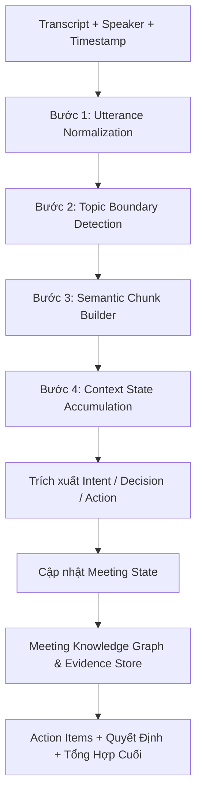
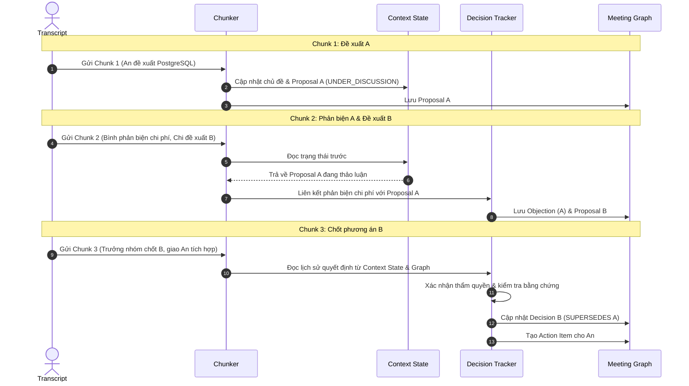

# Context-aware Chunking — Phân Đoạn Hội Thoại Duy Trì Ngữ Cảnh

Tài liệu này định nghĩa cơ chế phân đoạn cuộc họp thông minh (**Context-aware Chunking**) kết hợp duy trì trạng thái ngữ cảnh tích lũy (**Context State Tracking**) phục vụ cho hệ thống Trợ lý Cuộc họp AI (Meeting Intelligence Assistant).

---

## 1. Cơ Sở Lý Thuyết & Các Nghiên Cứu Tham Chiếu

Hệ thống kế thừa và phát triển từ hai công trình nghiên cứu khoa học then chốt:

### 1. Phân đoạn chủ đề không giám sát (*Unsupervised Topic Segmentation with BERT Embeddings*)
* **Cơ chế:** Nâng cấp thuật toán kinh điển TextTiling bằng mô hình Transformer (RoBERTa / Sentence-BERT).
* **Lọc nhiễu ASR bằng Max Pooling:** Sử dụng phép toán Max Pooling trên các vector biểu diễn câu để triệt tiêu các từ đệm vô nghĩa (*"ừm"*, *"kiểu như"*), giữ lại các đặc trưng ngữ nghĩa mạnh mẽ nhất.
* **Ngưỡng động (Dynamic Thresholding):** Xác định ranh giới chuyển chủ đề tại các điểm mà độ tương đồng Cosine giữa các khối tụt dốc đột ngột so với mặt bằng chung của cuộc họp ($sim_i < \mu_s - \sigma_s$).

### 2. Mô hình bóc tách quyết định 2 giai đoạn (*Meeting Decision Tracker — MDT*)
* **DUD (Decision Utterance Detector):** Gắn nhãn chuỗi cấp độ câu qua cửa sổ trượt 5 câu liên tiếp.
* **DUR (Decision Utterance Rewriter):** Khôi phục thông tin tỉnh lược (*Incomplete Utterance Restoration — IUR*), bỏ từ đệm và chuyển văn nói sang văn viết.
*(Chi tiết xem tại: [Ref-Meeting-Decision-Tracker-MDT.md](file:///d:/GENTALENT/Ref-Meeting-Decision-Tracker-MDT.md) và hướng dẫn thực thi tại [06-LLM-Agentic-Pipeline-Design.md](file:///d:/GENTALENT/06-LLM-Agentic-Pipeline-Design.md))*.

---

## 2. Vì Sao Fixed-Size Chunking (Cắt Đoạn Cố Định) Chưa Đủ?

Giả sử transcript cuộc họp được chia cố định theo số ký tự hoặc token:

* **CHUNK 1 — 00:05:10:**
  * *An:* “Tôi đề xuất dùng PostgreSQL vì dữ liệu của hệ thống có nhiều quan hệ.”
  * *Bình:* “Tôi đồng ý về mặt kỹ thuật, nhưng chi phí vận hành có thể cao.”
* **CHUNK 2 — 00:12:30:**
  * *Chi:* “Vậy chúng ta chọn giải pháp B nhé?”
  * *Trưởng nhóm:* “Đồng ý. An tích hợp trước thứ Sáu.”

Nếu CHUNK 2 được xử lý độc lập như một đoạn văn bản rời rạc, hệ thống sẽ **mất dấu hoàn toàn**:
* Không biết giải pháp B là gì và được chọn để giải quyết bài toán nào.
* Phương án PostgreSQL trước đó đã bị loại bỏ hay vẫn đang xem xét.
* Tại sao An lại là người được giao việc tích hợp.

### Ba vấn đề chí mạng của việc cắt đoạn cứng nhắc:
1. **Semantic Fragmentation (Phân mảnh ngữ nghĩa):** Một nội dung quan trọng bị cắt đôi ngay giữa chừng.
2. **Long-range Dependency (Phụ thuộc tầm xa):** Phát ngôn sau phụ thuộc vào thông tin đã xuất hiện từ rất lâu trước đó.
3. **Context Loss (Mất ngữ cảnh):** Mất dấu dòng trạng thái quyết định đang có hiệu lực.

---

## 3. Kiến Trúc Context-Aware Chunking Đề Xuất

Quy trình 4 bước từ transcript thô đến dữ liệu phân đoạn giàu ngữ cảnh:



### Bước 1 — Utterance Normalization (Chuẩn hóa lượt nói)
Chuẩn hóa transcript thành các lượt phát ngôn rõ ràng, bảo toàn:
* `utterance_id`, `speaker_id`, `speaker_role`
* `timestamp_start`, `timestamp_end`
* `text` nguyên văn
* Không cắt ngang giữa chừng một phát ngôn của người nói.

### Bước 2 — Topic Boundary Detection (Phát hiện ranh giới chủ đề)
Xác định thời điểm cuộc họp chuyển chủ đề dựa trên:
* Biến thiên độ tương đồng ngữ nghĩa (Cosine similarity dip).
* Từ khóa và thực thể nghiệp vụ đang được thảo luận.
* Tín hiệu hội thoại chuyển tiếp (*"chuyển sang vấn đề tiếp theo"*, *"quay lại chuyện ngân sách"*).
* Chương trình nghị sự (*Agenda*) nếu có.

### Bước 3 — Semantic Chunk Builder (Đóng gói đoạn ngữ nghĩa)
Mỗi chunk được xây dựng xoay quanh một chủ đề với cấu trúc đầy đủ:

| Trường dữ liệu | Kiểu dữ liệu | Mục đích |
| :--- | :--- | :--- |
| `chunk_id` | `string` | Định danh phân đoạn |
| `topic_id` | `string` | Chủ đề liên quan |
| `utterance_ids` | `array[string]` | Danh sách phát ngôn gốc trong đoạn |
| `start_time`, `end_time` | `timestamp` | Phạm vi thời gian của đoạn |
| `local_summary` | `string` | Tóm tắt nhanh nội dung đoạn |
| `entities` | `array[string]` | Nhân sự, dự án, tài liệu, phương án được nhắc đến |
| `open_questions` | `array[string]` | Các vấn đề còn tồn đọng chưa được giải quyết |

### Bước 4 — Context State (Trạng thái ngữ cảnh tích lũy)
Đây là trái tim của giải pháp: tạo đối tượng trạng thái ngữ cảnh tích lũy truyền qua các chunk:

```json
{
  "active_topics": ["database_selection"],
  "key_entities": ["PostgreSQL", "Solution B"],
  "proposals": [
    {
      "id": "PROP-A",
      "name": "PostgreSQL",
      "status": "UNDER_DISCUSSION"
    },
    {
      "id": "PROP-B",
      "name": "Solution B",
      "status": "PROPOSED"
    }
  ],
  "current_decision": null,
  "open_questions": [
    "Operating cost comparison"
  ],
  "pending_actions": [],
  "recent_utterance_ids": ["UTT-010", "UTT-011"]
}
```

---

## 4. Ba Chiến Lược Duy Trì Ngữ Cảnh

Hệ thống kết hợp cân bằng cả ba kỹ thuật:

1. **Overlapping Chunks (Gối đầu cục bộ):**
   * Cho $1 - 2$ phát ngôn cuối của chunk trước xuất hiện ở đầu chunk sau để giữ mạch câu trực tiếp.
2. **Running Context Summary (Tóm tắt trạng thái động):**
   * Duy trì đối tượng `Context State`, cập nhật liên tục sau mỗi chunk. Giúp tiết kiệm token tối đa mà không mất dấu diễn biến lớn.
3. **Graph-based Context Retrieval (Truy xuất đồ thị tầm xa):**
   * Khi xử lý chunk mới có nhắc lại chủ đề cũ từ đầu cuộc họp, truy vấn ngược lại các node `Proposal` / `Decision` trong Meeting Graph.

---

## 5. Tích Hợp Context-Aware Chunking Với Temporal Decision Tracking

Sơ đồ trình tự mô tả cách Chunker phối hợp với Decision Tracker và Meeting Graph:



Nhờ quy trình này, hệ thống không bao giờ cần nhồi nhét toàn bộ transcript thô vào mỗi lần gọi LLM. Mô hình chỉ cần **chunk hiện tại + Context State + thông tin truy xuất từ Graph**.

---

## 6. Bộ Chỉ Số Đánh Giá Chất Lượng Phân Đoạn

| Chỉ số (Metric) | Ý nghĩa đánh giá | Benchmark tham khảo |
| :--- | :--- | :--- |
| **Topic Segmentation F1** | Độ chính xác khi phát hiện ranh giới chuyển chủ đề | AMI Meeting Corpus |
| **Context-dependent Decision Accuracy** | Tỷ lệ nhận diện đúng quyết định khi bằng chứng nằm rải rác nhiều chunk | QMSum Dataset |
| **Action Item Extraction F1** | Độ đầy đủ và chính xác của các nhiệm vụ được trích xuất | Enterprise Benchmark |
| **Evidence Recall** | Tỷ lệ truy xuất đúng các câu phát ngôn làm bằng chứng gốc | Provenance Benchmark |
| **Token Cost / Latency** | Tối ưu hóa số lượng token và thời gian phản hồi | Cost Efficiency |

---

## 7. Lộ Trình Triển Khai MVP

1. **Chuẩn hóa lượt nói:** Phân tách transcript theo lượt phát ngôn, bảo toàn speaker, timestamp.
2. **Cắt chunk theo chủ đề:** Sử dụng LLM hoặc Embedding phát hiện ranh giới ngữ nghĩa.
3. **Quản lý Context State:** Tạo vòng lặp cập nhật `Context State` sau mỗi chunk.
4. **Trích xuất có cấu trúc:** Bóc tách Intent, Đề xuất, Quyết định và Action Items dựa trên chunk hiện tại và Context State.
5. **Cập nhật Meeting Graph:** Lưu các cạnh quan hệ (`SUPERSEDES`, `DERIVED_FROM`, `EVIDENCE_OF`).
6. **Kiểm thử kịch bản dài:** Đánh giá các cuộc họp mà đề xuất ở phút thứ 5 chỉ được chốt hoặc bác bỏ ở phút 50.