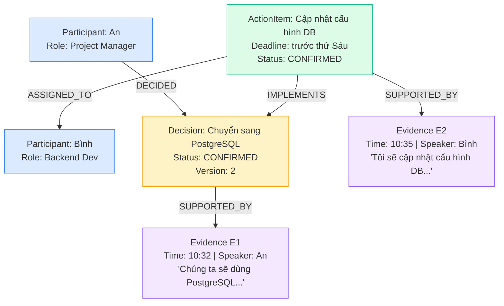
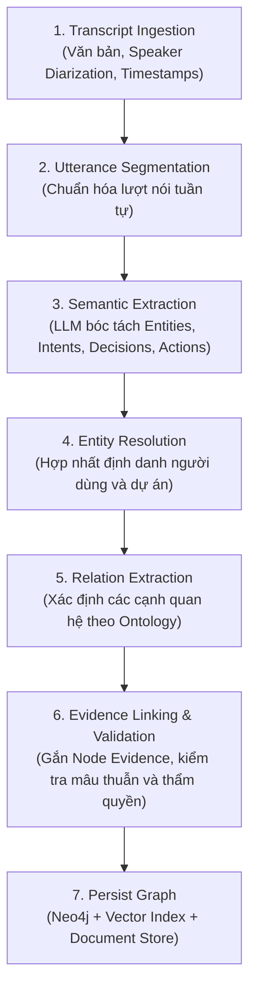

# Meeting Graph Construction — Xây Dựng Đồ Thị Tri Thức Cuộc Họp

Tài liệu này định nghĩa kiến trúc và phương pháp xây dựng **Đồ thị Tri thức Cuộc họp Lấy Bằng chứng làm Trọng tâm (Evidence-Centered Meeting Knowledge Graph)** phục vụ cho hệ thống Trợ lý Cuộc họp AI (Meeting Intelligence Assistant).

---

## 1. Tổng Quan & Vai Trò Của Graph Engineering

Trong một cuộc họp dài với nhiều người tham gia, các quyết định và công việc không tồn tại độc lập mà đan xen trong một mạng lưới các mối quan hệ phức tạp:
* Một phát ngôn có thể là **đề xuất**, **phản biện** một đề xuất cũ, hoặc **xác nhận** một quyết định mới.
* Một quyết định có thể **thay thế** một quyết định trước đó và **sinh ra** nhiều hành động cụ thể cho các thành viên khác nhau.
* Mọi quyết định và hành động đều phải có **bằng chứng đối chiếu** (*Evidence*) nằm tại các mốc thời gian cụ thể trong bản ghi âm/transcript.

> **Mục tiêu của Meeting Graph:** Chuyển đổi cuộc hội thoại phi cấu trúc thành một mạng lưới tri thức có thể truy vết (*Auditability / Provenance*), giải thích được (*Explainability*) và thực thi được (*Actionability*).

---

## 2. Các Loại Node Trong Meeting Graph

Hệ thống thiết kế một schema chuyên biệt cho cuộc họp, bao gồm 9 loại Node thực thể:

| Loại Node | Ý nghĩa | Các thuộc tính quan trọng |
| :--- | :--- | :--- |
| **`Meeting`** | Phiên họp | `meeting_id`, `title`, `start_time`, `end_time`, `project_id` |
| **`Participant`** | Người tham gia | `participant_id`, `name`, `email`, `role` (Host, Lead, Dev, PM) |
| **`Utterance`** | Lượt phát ngôn nguyên văn | `utterance_id`, `speaker_id`, `timestamp_start`, `timestamp_end`, `text` |
| **`Topic`** | Chủ đề thảo luận | `topic_id`, `name`, `status` (OPEN, CLOSED) |
| **`Decision`** | Quyết định đã chốt | `decision_id`, `content`, `status` (PROPOSED, CONFIRMED, SUPERSEDED), `version` |
| **`ActionItem`** | Công việc cần thực hiện | `action_id`, `action_text`, `deadline`, `status` (PENDING, DONE), `priority` |
| **`Evidence`** | Bằng chứng nguồn gốc | `evidence_id`, `transcript_id`, `start_time_ms`, `end_time_ms`, `quote_text`, `confidence` |
| **`Issue`** | Vấn đề / Rủi ro phát sinh | `issue_id`, `description`, `severity` (LOW, MEDIUM, HIGH), `status` |
| **`Entity`** | Thực thể nghiệp vụ | `entity_id`, `type` (Repository, Database, API, Product), `name` |

---

## 3. Thiết Kế Edges — Các Quan Hệ Trong Graph

Các cạnh (Edges) định nghĩa sự tương tác ngữ nghĩa và dòng thông tin giữa các thực thể:

| Tên Edge | Từ Node $\longrightarrow$ Đến Node | Ý nghĩa quan hệ |
| :--- | :--- | :--- |
| **`ATTENDED`** | `Participant` $\longrightarrow$ `Meeting` | Người tham gia cuộc họp |
| **`SPOKE`** | `Participant` $\longrightarrow$ `Utterance` | Ai là người phát biểu câu nói này |
| **`NEXT`** | `Utterance` $\longrightarrow$ `Utterance` | Thứ tự thời gian giữa các phát ngôn |
| **`BELONGS_TO`** | `Utterance` $\longrightarrow$ `Topic` | Phát ngôn thuộc chủ đề nào |
| **`PROPOSED`** | `Participant` $\longrightarrow$ `Decision` | Ai là người đề xuất phương án |
| **`DECIDED_IN`** | `Decision` $\longrightarrow$ `Meeting` | Quyết định được đưa ra trong cuộc họp nào |
| **`ASSIGNED_TO`** | `ActionItem` $\longrightarrow$ `Participant` | Ai chịu trách nhiệm thực thi nhiệm vụ |
| **`IMPLEMENTS`** | `ActionItem` $\longrightarrow$ `Decision` | Công việc này phục vụ cho quyết định nào |
| **`SUPPORTED_BY`** | `Decision` / `ActionItem` $\longrightarrow$ `Evidence` | Bằng chứng đối chiếu gốc trong transcript |
| **`SUPERSEDES`** | `Decision` $\longrightarrow$ `Decision` | Quyết định mới thay thế quyết định cũ |
| **`CONTRADICTS`** | `Utterance` / `Claim` $\longrightarrow$ `Utterance` / `Claim` | Hai phát ngôn hoặc lập luận mâu thuẫn nhau |
| **`REFERENCES`** | `ActionItem` / `Decision` $\longrightarrow$ `Entity` | Nhiệm vụ liên quan đến dự án/hệ thống/kho mã nào |

> [!TIP]
> **Ưu tiên cho giai đoạn MVP:** Tập trung xây dựng 6 cạnh quan hệ cốt lõi: `SPOKE`, `BELONGS_TO`, `ASSIGNED_TO`, `IMPLEMENTS`, `SUPPORTED_BY`, và `SUPERSEDES`.

---

## 4. Evidence Linking — Cơ Chế Liên Kết Bằng Chứng

Nếu AI trích xuất một quyết định hoặc nhiệm vụ nhưng không thể chỉ ra câu nói nào làm bằng chứng, người dùng sẽ không tin tưởng hệ thống. Lấy cảm hứng từ cấu trúc `TextUnit` của **Microsoft GraphRAG**, hệ thống liên kết mọi thông tin với phát ngôn gốc:

### Sơ đồ trực quan hóa liên kết bằng chứng (Ví dụ thực tế):



### Cấu trúc dữ liệu Node Evidence:
```json
{
  "evidence_id": "EV-001",
  "meeting_id": "MEET-20261013-01",
  "transcript_id": "TRANS-042",
  "speaker_id": "USR-AN",
  "start_time_ms": 632000,
  "end_time_ms": 642000,
  "quote_text": "Chúng ta sẽ dùng PostgreSQL thay cho MySQL trong phiên bản tiếp theo.",
  "source_type": "transcript",
  "extraction_confidence": 0.94
}
```

> [!IMPORTANT]
> **Quy tắc về bằng chứng:**
> 1. `extraction_confidence` là độ tin cậy của thuật toán bóc tách, không đồng nghĩa với tính đúng đắn tuyệt đối của phát ngôn.
> 2. Nếu có nhiều câu nói cùng ủng hộ hoặc phản bác một quyết định, hệ thống **lưu toàn bộ các bằng chứng liên quan** thay vì chỉ giữ lại một câu duy nhất.

---

## 5. Pipeline 7 Bước Xây Dựng Meeting Graph

Quy trình tuần tự từ dữ liệu đa phương tiện thô đến đồ thị tri thức hoàn chỉnh:



### Các nguyên tắc kỹ thuật bất biến (Gold Rules):
1. **Không đồng nhất đề xuất với quyết định:** `PROPOSED` $\neq$ `CONFIRMED`. Phải kiểm tra tín hiệu đồng thuận hoặc vai trò của người chốt (*Authority Check*).
2. **Không tự đoán người làm:** Phát ngôn *"Để tôi làm cho"* chỉ được gán việc khi định danh người nói (*Speaker ID*) có độ tin cậy cao.
3. **Bảo toàn lịch sử (Provenance):** Khi quyết định thay đổi, tạo Node mới với cạnh `SUPERSEDES`, không âm thầm ghi đè lịch sử.
4. **Tách rời dữ liệu nguồn và dữ liệu suy diễn:** Phát ngôn nguyên văn và phân tích của AI phải được lưu ở 2 tầng khác nhau.
5. **Kiểm tra đồ thị trước khi ghi (Pre-write Graph Validation):** Loại bỏ cạnh thiếu nguồn, node mồ côi, hoặc quan hệ vi phạm ràng buộc schema.

---

## 6. Kiến Trúc Công Nghệ Đề Xuất

| Thành phần | Công nghệ khởi đầu | Vai trò trong hệ thống |
| :--- | :--- | :--- |
| **Trích xuất Node & Edge** | LLM (Gemini / GPT) + Pydantic | Bóc tách dữ liệu có cấu trúc theo schema |
| **Entity Resolution** | Rule-based + Cosine Embedding + LLM | Hợp nhất tên gọi (ví dụ: *"anh An"*, *"An"*, *"PM An"*) |
| **Graph Database** | **Neo4j** | Lưu trữ Nodes, Edges và thực hiện truy vấn đường đi (*Graph Traversal*) |
| **Evidence Storage** | PostgreSQL hoặc Document Store | Lưu transcript gốc, timestamps và lịch sử phiên bản |
| **Semantic Retrieval** | Vector Index (Chroma / Pinecone / pgvector) | Tìm kiếm phát ngôn và chủ đề tương đồng |
| **Graph-enhanced RAG** | Neo4j + Vector Hybrid RAG (hoặc GraphRAG) | Kết hợp quan hệ đồ thị và văn bản nguồn để trả lời câu hỏi phức tạp |

---

## 7. Bộ Chỉ Số Đánh Giá Chất Lượng Meeting Graph

Đánh giá chất lượng đồ thị thông qua các thước đo định lượng:

| Chỉ số (Metric) | Câu hỏi cần trả lời | Mục tiêu đánh giá |
| :--- | :--- | :--- |
| **Entity Precision / Recall / F1** | Bóc tách đúng Người, Nhiệm vụ, Quyết định đến mức nào? | Độ chính xác nhận diện thực thể |
| **Relation F1** | Các quan hệ như `ASSIGNED_TO`, `IMPLEMENTS`, `SUPERSEDES` có đúng không? | Tính chính xác của liên kết ngữ nghĩa |
| **Evidence Coverage** | Tỷ lệ node/edge quan trọng có thể truy ngược về bằng chứng nguồn? | Mục tiêu $\ge 98\%$ có bằng chứng |
| **Evidence Localization** | Bằng chứng có trỏ đúng vị trí câu và timestamp trong transcript không? | Độ chính xác mốc thời gian |
| **Entity Resolution Accuracy** | Cùng một người hoặc dự án có bị tách thành nhiều node trùng lặp không? | Độ sạch của đồ thị |
| **Temporal Consistency** | Deadline, thứ tự sự kiện và lịch sử quyết định có nhất quán không? | Tính hợp lý theo dòng thời gian |
| **Multi-hop Query Success** | Hệ thống có trả lời đúng các câu: *"Vì sao chọn B?", "Ai phản đối A?", "Bằng chứng ở đâu?"* | Hiệu năng giải trình cuối cùng |

---

## 8. Hướng Triển Khai Phù Hợp Cho MVP

Với giai đoạn đầu của dự án, ưu tiên triển khai mô hình **Evidence-Centered Meeting Knowledge Graph**:
1. **Ontology tối giản:** Giới hạn 5 loại node (`Meeting`, `Participant`, `Decision`, `ActionItem`, `Evidence`) và 5 loại quan hệ cốt lõi.
2. **Graph Construction qua LLM API:** Tận dụng Structured Model Outputs (xem chi tiết tại [06-LLM-Agentic-Pipeline-Design.md](file:///d:/GENTALENT/06-LLM-Agentic-Pipeline-Design.md)) để trích xuất trực tiếp JSON chứa nodes và edges.
3. **Evidence Provenance:** Đảm bảo mọi ActionItem đều có trường `evidence_utterance_id` và timestamp đối chiếu.

---

## 9. Tài Liệu Tham Chiếu Chéo (Cross-References)
* [00-Tong-Quan-Tri-Tue-Cuoc-Hop.md](file:///d:/GENTALENT/00-Tong-Quan-Tri-Tue-Cuoc-Hop.md) — Tổng quan bài toán & mục tiêu Mission 1.
* [01-Semantic-Intent-Schema.md](file:///d:/GENTALENT/01-Semantic-Intent-Schema.md) — Đặc tả dữ liệu 3 lớp và Intent Taxonomy.
* [02-Temporal-Decision-Tracking.md](file:///d:/GENTALENT/02-Temporal-Decision-Tracking.md) — Cơ chế theo dõi sự thay đổi quyết định theo thời gian (`SUPERSEDES`).
* [03-Context-Aware-Chunking.md](file:///d:/GENTALENT/03-Context-Aware-Chunking.md) — Cơ chế phân đoạn hội thoại và duy trì Context State.
* [06-LLM-Agentic-Pipeline-Design.md](file:///d:/GENTALENT/06-LLM-Agentic-Pipeline-Design.md) — Hướng dẫn kiến trúc triển khai thực chiến với LLM API.