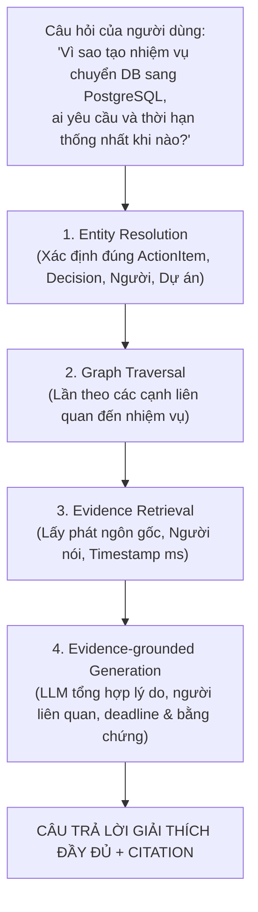
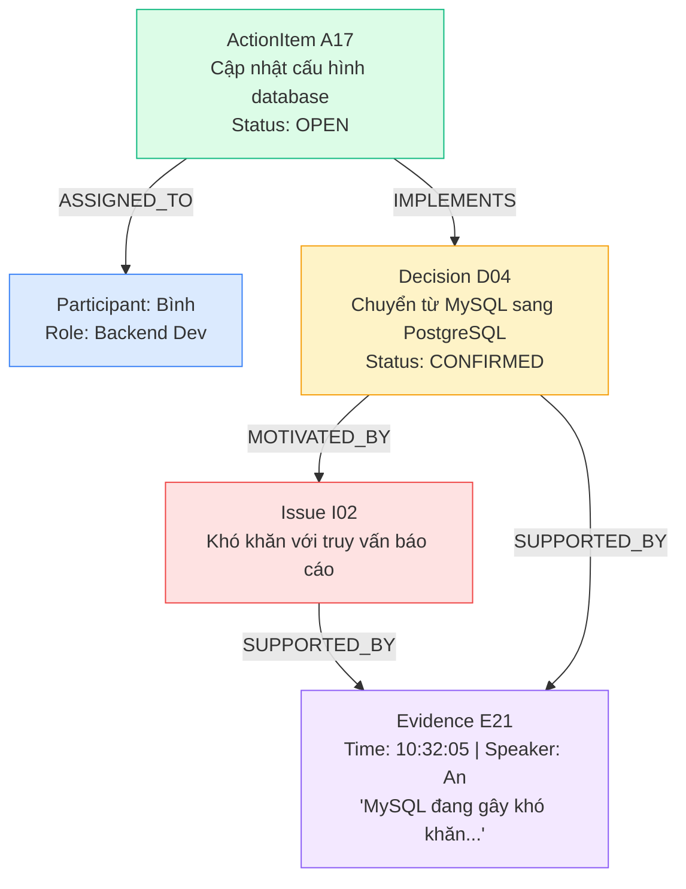

# Graph Retrieval — Truy Vấn & Khai Thác Đồ Thị Tri Thức Cuộc Họp

Tài liệu này định nghĩa kiến trúc, các chiến lược truy vấn và phương pháp khai thác **Đồ thị Tri thức Cuộc họp (Graph Retrieval)**, kết hợp giữa mô hình đồ thị quan hệ và mô hình ngôn ngữ lớn (LLM) để phục vụ cho hệ thống Trợ lý Cuộc họp AI (Meeting Intelligence Assistant).

---

## 1. Tổng Quan: Vì Sao Vector RAG Truyền Thống Thất Bại?

Giả sử người dùng hỏi:
> *“Vì sao chúng ta tạo nhiệm vụ chuyển database sang PostgreSQL, ai yêu cầu và thời hạn được thống nhất khi nào?”*

Một hệ thống chỉ dùng **Naive Vector RAG** (tìm kiếm tương đồng ngữ nghĩa bằng Cosine Similarity) có thể tìm được phát ngôn nhắc đến từ khóa *"PostgreSQL"*. Nhưng để trả lời trọn vẹn câu hỏi trên, hệ thống buộc phải kết nối nhiều mảnh ghép thông tin nằm rải rác:
* Lời phàn nàn ban đầu về MySQL (phút thứ 10).
* Đề xuất giải pháp và phản biện (phút thứ 12).
* Lời chốt quyết định của trưởng nhóm (phút thứ 20).
* Nhiệm vụ giao cho kỹ sư kèm thời hạn (phút thứ 21).

Vector search không thể liên kết chuỗi nhân quả nhiều bước (*Multi-hop Causal Chain*) này. **Graph Retrieval** giải quyết triệt để vấn đề bằng cách duyệt theo các cạnh quan hệ thực thể.

---

## 2. Luồng Hoạt Động 4 Bước Của Graph Retrieval

Quy trình truy vấn ngược dựa trên nguyên tắc **Local Search** của Microsoft GraphRAG:



1. **Entity Resolution:** Phân tích câu hỏi để định vị đúng các thực thể cốt lõi trong Graph (`ActionItem: A17`, `Decision: D04`, `Participant: Bình, An`).
2. **Graph Traversal:** Duyệt qua các cạnh quan hệ liên quan (`IMPLEMENTS`, `MOTIVATED_BY`, `ASSIGNED_TO`, `SUPERSEDES`).
3. **Evidence Retrieval:** Kéo toàn bộ các Node `Evidence` làm bằng chứng nguồn (ID, câu trích dẫn, mốc thời gian).
4. **Evidence-grounded Generation:** Đưa Subgraph và Evidence vào LLM để sinh câu trả lời có căn cứ xác thực, loại bỏ hoàn toàn ảo giác.

---

## 3. Ví Dụ: Truy Vấn Ngược Từ Nhiệm Vụ Về Lý Do Tạo Ra Nó

Giả sử transcript cuộc họp ghi nhận chuỗi sự kiện:
* *10:32:05 — An phát biểu:* “MySQL đang gây khó khăn khi xử lý các truy vấn báo cáo.”
* *10:33:00 — An đề xuất:* “Chúng ta nên chuyển sang PostgreSQL.”
* *10:34:30 — Nhóm thống nhất:* Chốt chuyển cơ sở dữ liệu.
* *10:35:00 — Bình được giao việc:* Cập nhật cấu hình trước thứ Sáu.

### Sơ đồ mô hình hóa chuỗi nhân quả trong Graph:



> [!NOTE]
> **Quan hệ `MOTIVATED_BY`:** Hệ thống chỉ tạo cạnh `MOTIVATED_BY` khi transcript có bằng chứng trực tiếp xác nhận mối liên hệ giữa vấn đề và quyết định, không suy diễn chỉ vì hai thông tin xuất hiện gần nhau.

Khi truy vấn `A17`, hệ thống duyệt theo đường đi để tìm:
$$\text{ActionItem (A17)} \longrightarrow \text{Decision (D04)} \longrightarrow \text{Issue (I02)} \longrightarrow \text{Evidence (E21)}$$
Đây chính là sức mạnh của Graph Traversal: **Truy xuất toàn bộ chuỗi quan hệ logic nhân quả thay vì chỉ tìm kiếm một câu nói rời rạc.**

---

## 4. Các Chiến Lược Graph Retrieval

Hệ thống kết hợp các chiến lược truy vấn tùy theo mục đích của câu hỏi:

| Chiến lược | Cách thức hoạt động | Câu hỏi mẫu phù hợp |
| :--- | :--- | :--- |
| **Entity-based Retrieval** | Tìm kiếm node theo tên, ID hoặc embedding | *“Nhiệm vụ cập nhật database là gì?”* |
| **Graph Traversal** | Lần theo các cạnh quan hệ từ node xuất phát | *“Ai phụ trách nhiệm vụ này và nó liên quan đến quyết định nào?”* |
| **Hybrid Graph + Vector** | Kết hợp tìm node/đường đi trên graph với tìm kiếm ngữ nghĩa transcript | *“Vì sao nhóm lại quyết định chuyển database?”* |
| **Local Search** *(GraphRAG)* | Kết hợp thực thể, quan hệ cục bộ và các đoạn văn bản nguồn xung quanh | *“Giải thích quyết định D04 bằng lịch sử thảo luận.”* |
| **Global Search / DRIFT** *(GraphRAG)* | Tổng hợp báo cáo về các nhóm chủ đề/thực thể trên toàn bộ kho dữ liệu | *“Những lý do phổ biến khiến dự án phải thay đổi kiến trúc trong quý này là gì?”* |

> [!TIP]
> **Khuyến nghị cho dự án:** Với bài toán giải thích lý do của nhiệm vụ hoặc quyết định, hãy bắt đầu bằng **Hybrid Retrieval kết hợp Graph Traversal và Evidence Linking**. Chưa cần dùng Global Search cho mọi câu hỏi để tối ưu tốc độ và chi phí.

---

## 5. Thiết Kế Dữ Liệu Phục Vụ Graph Retrieval

Để đảm bảo truy vấn ngược chuẩn xác, các Node và Edge cần có đủ thông tin định danh và nguồn gốc (*Provenance*):

### Cấu trúc Action Item phục vụ truy vấn:
```json
{
  "action_item_id": "A17",
  "description": "Cập nhật cấu hình database",
  "assignee_id": "P02",
  "related_decision_id": "D04",
  "deadline": {
    "value": null,
    "raw_text": "trước thứ Sáu",
    "resolution_status": "needs_temporal_resolution"
  },
  "evidence_ids": ["E21", "E22"],
  "status": "open"
}
```
* `value` để `null` vì chưa được phân giải với ngày họp thực tế.
* `raw_text: "trước thứ Sáu"` được giữ nguyên để chống ảo giác tự bịa ngày tháng.

### Các trường dữ liệu bắt buộc của Node Evidence:
* `evidence_id`, `meeting_id`, `transcript_id`
* `speaker_id`, `start_time_ms`, `end_time_ms`
* `text` nguyên văn câu phát ngôn và phiên bản transcript
* Loại quan hệ hoặc claim mà evidence hỗ trợ
* Trạng thái xác minh (*verification_status*)

---

## 6. Mẫu Truy Vấn Bằng Neo4j Cypher Thực Tế

Truy vấn tìm toàn bộ chuỗi nhân quả: từ nhiệm vụ $\rightarrow$ quyết định $\rightarrow$ vấn đề $\rightarrow$ người làm $\rightarrow$ bằng chứng nguồn:

```cypher
MATCH (a:ActionItem {id: $action_id})-[:IMPLEMENTS]->(d:Decision)
OPTIONAL MATCH (d)-[:MOTIVATED_BY]->(i:Issue)
OPTIONAL MATCH (d)-[:SUPPORTED_BY]->(e:Evidence)
OPTIONAL MATCH (a)-[:ASSIGNED_TO]->(p:Participant)
RETURN
    a.description AS task,
    d.description AS decision,
    i.description AS reason,
    p.name AS assignee,
    collect(DISTINCT {
        evidence_id: e.id,
        text: e.text,
        timestamp: e.timestamp
    }) AS evidence_list;
```

> **Lưu ý thiết kế:** Sử dụng `OPTIONAL MATCH` cho phép hệ thống trả về thông tin nhiệm vụ ngay cả khi chưa tìm thấy lý do hoặc evidence, đồng thời ứng dụng có thể hiển thị rõ các phần còn thiếu để người dùng nắm bắt.

---

## 7. Bộ Thước Đo Đánh Giá Chất Lượng Graph Retrieval

Đánh giá module Graph Retrieval không chỉ dựa trên chất lượng văn bản sinh ra, mà cần đo lường độc lập chất lượng truy xuất:

| Chỉ số (Metric) | Câu hỏi cần trả lời | Mục tiêu đánh giá |
| :--- | :--- | :--- |
| **Evidence Recall@k** | Tỷ lệ bằng chứng đúng được tìm thấy trong top-k kết quả? | Độ nhạy truy xuất bằng chứng |
| **Path Correctness** | Đường đi duyệt trên đồ thị có phản ánh đúng quan hệ nghiệp vụ không? | Tính chính xác của liên kết logic |
| **Evidence Coverage** | Các lý do hoặc kết luận được nêu trong câu trả lời có nguồn hỗ trợ không? | Tính đầy đủ của dẫn chứng |
| **Answer Faithfulness** | Câu trả lời của LLM có bám sát bằng chứng hay tự suy diễn thêm? | Mục tiêu $0\%$ ảo giác |
| **Retrieval Latency** | Tổng thời gian truy vấn Graph, Vector Index và trích xuất bằng chứng? | Thời gian phản hồi $\le 1.5$ giây |
| **Abstention Accuracy** | Hệ thống có biết nói *“chưa đủ bằng chứng trong cuộc họp”* khi không tìm thấy lý do xác đáng không? | Tránh cưỡng ép sinh câu trả lời bừa |

---

## 8. Kết Luận & Hướng Triển Khai Cho Dự Án

**Định nghĩa module Graph Retrieval của dự án:**
> *Graph Retrieval truy xuất lịch sử thảo luận bằng cách xác định các thực thể liên quan, duyệt qua quan hệ giữa nhiệm vụ, quyết định, vấn đề và người tham gia, sau đó kéo các phát ngôn gốc làm bằng chứng. Kết quả được đưa vào LLM để tạo lời giải thích có thể kiểm chứng, đồng thời chỉ ra những thông tin còn thiếu hoặc chưa được xác nhận.*

### Thứ tự triển khai ưu tiên:
1. **Thiết lập các quan hệ cốt lõi:** `IMPLEMENTS`, `MOTIVATED_BY`, `ASSIGNED_TO`, `SUPPORTED_BY`, `SUPERSEDES`.
2. **Xây dựng Cypher Templates:** Duyệt từ Nhiệm vụ $\rightarrow$ Quyết định $\rightarrow$ Vấn đề $\rightarrow$ Bằng chứng.
3. **Kết hợp Vector Search:** Tìm kiếm các phát ngôn liên quan về mặt ngữ nghĩa nhưng chưa kịp nối cạnh vào Graph.
4. **Sinh câu trả lời bám sát bằng chứng:** Kèm timestamp và người nói.
5. **Kiểm thử trên các câu hỏi thực tế:** *"Vì sao?", "Ai yêu cầu?", "Quyết định dựa trên phát ngôn nào?", "Có bằng chứng nào phản bác quyết định này không?"*.

---

## 9. Tài Liệu Tham Chiếu Chéo (Cross-References)
* [00-Tong-Quan-Tri-Tue-Cuoc-Hop.md](file:///d:/GENTALENT/00-Tong-Quan-Tri-Tue-Cuoc-Hop.md) — Tổng quan bài toán & mục tiêu Mission 1.
* [01-Semantic-Intent-Schema.md](file:///d:/GENTALENT/01-Semantic-Intent-Schema.md) — Đặc tả dữ liệu 3 lớp và Intent Taxonomy.
* [02-Temporal-Decision-Tracking.md](file:///d:/GENTALENT/02-Temporal-Decision-Tracking.md) — Cơ chế theo dõi sự thay đổi quyết định theo thời gian (`SUPERSEDES`).
* [03-Context-Aware-Chunking.md](file:///d:/GENTALENT/03-Context-Aware-Chunking.md) — Phân đoạn cuộc họp & duy trì Context State.
* [04-Meeting-Graph-Construction.md](file:///d:/GENTALENT/04-Meeting-Graph-Construction.md) — Kiến trúc xây dựng đồ thị tri thức cuộc họp lấy bằng chứng làm trọng tâm.
* [Ref-Microsoft-GraphRAG-Analysis.md](file:///d:/GENTALENT/Ref-Microsoft-GraphRAG-Analysis.md) — Nghiên cứu tham chiếu về GraphRAG của Microsoft Research (Local vs. Global Search).
* [06-LLM-Agentic-Pipeline-Design.md](file:///d:/GENTALENT/06-LLM-Agentic-Pipeline-Design.md) — Hướng dẫn kiến trúc triển khai Agentic Workflow với LLM API.
