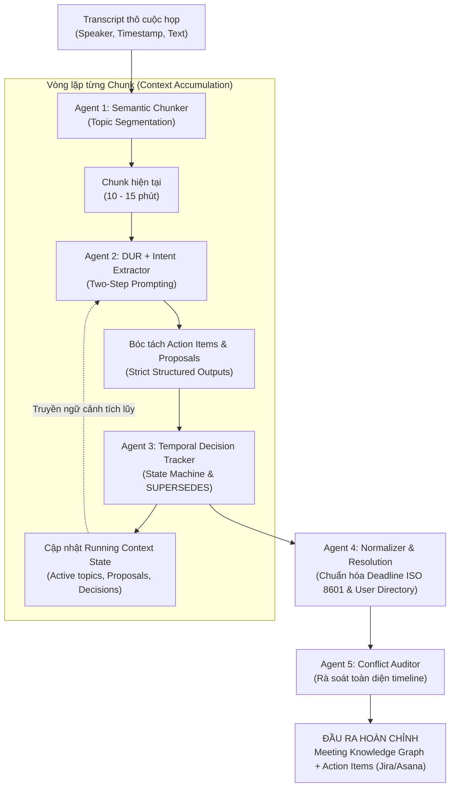

# Kiến Trúc Agentic Pipeline Cho Trí Tuệ Cuộc Họp (Triển Khai LLM API)

Tài liệu này hướng dẫn cách chuyển hóa toàn bộ các nghiên cứu học thuật (**Meeting Decision Tracker**, **Unsupervised Topic Segmentation**, **Context-aware Chunking**, **Temporal Decision Tracking**) thành một **hệ thống đa tác nhân (Agentic Workflow)** thực chiến, tận dụng tối đa sức mạnh của các mô hình ngôn ngữ lớn (Gemini 1.5 Pro/Flash, GPT-4o) khi **được phép gọi API không giới hạn**.

---

## 1. Lợi Thế Khi Có Tài Nguyên Call API Thoải Mái

Khi không bị ràng buộc bởi chi phí token hay giới hạn tính toán phần cứng cục bộ:
* **Không cần tự huấn luyện các mô hình nhỏ cũ kỹ:** Bỏ qua việc fine-tune BERT cho Sequence Labeling hay T5 cho Rewriting (vốn phức tạp và điểm $F_1$ chỉ khoảng $0.51$).
* **Không cần tính toán vector cosine thủ công:** Tận dụng khả năng suy luận ngữ dụng (*pragmatic reasoning*) của LLM để nhận diện ranh giới chủ đề và quan hệ phức tạp.
* **Tập trung vào Agentic Workflow & Structured Outputs:** Xây dựng hệ thống gồm nhiều Agent chuyên biệt hóa phối hợp với nhau, ép khuôn dữ liệu bằng Pydantic / JSON Schema nghiêm ngặt.

---

## 2. 5 Chiến Lược Kế Thừa & Nâng Cấp Từ Các Bài Báo



---

### Chiến lược 1: Áp dụng triết lý DUR — Kỹ thuật Two-Step Prompting
* **Vấn đề:** Văn nói tự nhiên trong cuộc họp rất cộc lốc, nhiều từ đệm (*fillers*), tỉnh lược chủ/vị (*ellipses*) và dùng nhiều đại từ (*co-references: "cái đó", "làm đi"*). Nếu ép LLM bóc tách JSON ngay, mô hình rất dễ nhầm lẫn.
* **Giải pháp:** Sử dụng Chain-of-Thought (CoT) bắt buộc LLM thực hiện bước **De-contextualization (Viết lại câu)** trước khi bóc tách schema:
  1. *Bước 1 (Viết lại):* Khôi phục thông tin lược bỏ, giải quyết đại từ thay thế, bỏ từ đệm.
     *(Ví dụ: "Thôi chọn cái B đi, An làm trước thứ Sáu" $\rightarrow$ "Trưởng nhóm quyết định chọn Giải pháp B thay thế cho PostgreSQL; giao cho An tích hợp trước thứ Sáu.")*
  2. *Bước 2 (Trích xuất):* Bóc tách các trường `action`, `assignee`, `object`, `deadline` từ câu văn đã chuẩn hóa.

---

### Chiến lược 2: Áp dụng Context-aware Chunking — Running State Accumulator
* **Vấn đề:** Dù LLM có Context Window 1M+ tokens, việc nhét cả cuộc họp 90 phút vào một prompt duy nhất sẽ gây ra hiệu ứng **"Lost in the Middle"** (bỏ sót quyết định ở giữa) và mất tính tuần tự thời gian.
* **Giải pháp:** Chia cuộc họp thành các đoạn 10–15 phút và xử lý tuần tự qua một đối tượng trạng thái tích lũy (`Context State`):

```python
# Mô hình State Accumulator lặp qua từng Chunk
accumulated_state = {
    "active_proposals": {},
    "current_decisions": {},
    "open_issues": []
}

for chunk in meeting_chunks:
    response = call_llm(
        system_prompt=SYSTEM_PROMPT_CHUNKER,
        user_prompt=f"""
        Ngữ cảnh đã tích lũy từ các phần trước:
        {json.dumps(accumulated_state, ensure_ascii=False)}

        Nội dung đoạn hội thoại hiện tại:
        {chunk.text}
        """,
        response_format=ChunkExtractionResult  # Pydantic Model
    )
    # Cập nhật trạng thái ngữ cảnh tích lũy
    accumulated_state = response.updated_state
```

---

### Chiến lược 3: Ép khuôn tuyệt đối bằng "Strict Structured Model Outputs"
Tận dụng tính năng Structured Outputs của OpenAI (`response_format` JSON Schema) hoặc Gemini (`response_schema` với Pydantic):
* **Type-Safety & Zero Format Error:** Đảm bảo $100\%$ đầu ra tuân thủ đúng cấu trúc, không thiếu key, không sai kiểu enum.
* **Null-Safety chống ảo giác:**
  * Quy định rõ `assignee: Optional[Person] = None`, `deadline: Optional[Deadline] = None`.
  * Nếu người nói chưa chốt ai làm hoặc khi nào nộp, LLM bắt buộc trả về `null` thay vì tự ý bịa thông tin.

---

### Chiến lược 4: Post-Meeting Temporal Resolution Agent (Chuẩn hóa thời gian thực)
Trong cuộc họp, mọi người dùng các mốc thời gian tương đối (*"trước thứ Sáu"*, *"sang tuần sau"*, *"cuối tháng"*).
* Gọi 1 lượt API chuyên biệt sau khi cuộc họp kết thúc:
  * **Input:** Danh sách Action Items + Metadata cuộc họp (`meeting_datetime = "2026-10-13T09:00:00+07:00"`).
  * **Output:** Tính toán chuẩn xác ngày giờ theo chuẩn ISO-8601:
    $$\text{"trước 17h thứ Sáu"} \xrightarrow[\text{Họp ngày 13/10/2026}]{\text{Resolution Agent}} \text{"2026-10-16T17:00:00+07:00"}$$

---

### Chiến lược 5: Multi-Agent Conflict Auditor (Kiểm định xung đột quyết định)
Sử dụng một Agent độc lập rà soát lại toàn bộ timeline cuộc họp:
* So sánh các quyết định ở đầu cuộc họp và cuối cuộc họp.
* Thiết lập chính xác quan hệ `SUPERSEDES`: Giải thích lý do vì sao phương án ban đầu bị hủy bỏ, phương án nào được chọn thay thế, và dẫn link bằng chứng (*evidence utterance*).

---

## 3. Mã Nguồn Mẫu Triển Khai Thực Chiến (Pydantic & Python)

```python
from typing import List, Optional
from enum import Enum
from pydantic import BaseModel, Field

class IntentType(str, Enum):
    CREATE_TASK = "CREATE_TASK"
    ASSIGN_TASK = "ASSIGN_TASK"
    PROPOSE_OPTION = "PROPOSE_OPTION"
    OPPOSE_PROPOSAL = "OPPOSE_PROPOSAL"
    SUPPORT_PROPOSAL = "SUPPORT_PROPOSAL"
    CONFIRM_DECISION = "CONFIRM_DECISION"
    SUPERSEDE_DECISION = "SUPERSEDE_DECISION"
    DISCUSS_TOPIC = "DISCUSS_TOPIC"

class TaskStatus(str, Enum):
    PROPOSED = "PROPOSED"
    CONFIRMED = "CONFIRMED"
    SUPERSEDED = "SUPERSEDED"

class Assignee(BaseModel):
    name: str
    role: Optional[str] = None

class DeadlineInfo(BaseModel):
    raw_text: str = Field(description="Cụm từ chỉ thời gian nguyên văn trong lời nói, ví dụ: 'thứ Sáu'")
    normalized_iso: Optional[str] = Field(default=None, description="Thời gian chuẩn ISO-8601 nếu đã tính được")

class ActionItemSchema(BaseModel):
    action_id: str
    action_description: str
    decontextualized_text: str = Field(description="Câu văn được viết lại hoàn chỉnh theo kỹ thuật DUR")
    assignee: Optional[Assignee] = None
    deadline: Optional[DeadlineInfo] = None
    completion_criteria: List[str] = Field(default_factory=list)
    status: TaskStatus
    evidence_utterance_id: str
    confidence: float

class DecisionEventSchema(BaseModel):
    event_type: str = Field(description="PROPOSAL_CREATED, OBJECTION_RAISED, DECISION_CONFIRMED")
    proposal_name: str
    reason: Optional[str] = None
    supersedes_proposal: Optional[str] = None
    evidence_text: str

class ChunkProcessingOutput(BaseModel):
    topic_summary: str
    action_items: List[ActionItemSchema]
    decision_events: List[DecisionEventSchema]
    unresolved_questions: List[str]
```

---

## 4. Prompt Template Mẫu Cho Agent Trích Xuất (Production Prompt)

```text
Bạn là Trợ lý Trí Tuệ Cuộc Họp cấp cao (Meeting Intelligence Assistant).
Nhiệm vụ của bạn là phân tích đoạn transcript hiện tại dựa trên Context State đã tích lũy từ các phần trước.

[QUY TẮC BẮT BUỘC]:
1. ÁP DỤNG KỸ THUẬT DE-CONTEXTUALIZATION (DUR):
   - Trước khi trích xuất, hãy viết lại câu phát ngôn thành câu văn hoàn chỉnh, rõ ràng, khôi phục các chủ ngữ/tân ngữ bị lược bỏ (ví dụ: thay "nó", "cái đó" bằng tên giải pháp cụ thể).
2. NGUYÊN TẮC NULL-SAFETY (CHỐNG ẢO GIÁC):
   - Nếu trong câu chưa nêu rõ người phụ trách, trường `assignee` BẮT BUỘC để null.
   - Nếu chưa chốt thời hạn cụ thể, trường `deadline.raw_text` giữ nguyên văn nói, không tự ý suy diễn ngày tháng.
3. THEO DÕI QUYẾT ĐỊNH (TEMPORAL TRACKING):
   - Kiểm tra xem quyết định mới có bác bỏ hoặc thay thế (SUPERSEDES) đề xuất cũ nào trong Context State không.
   - Ghi nhận nguyên nhân phản biện (chi phí, tiến độ, kỹ thuật) làm căn cứ thay đổi.
```

---

## 5. Tài Liệu Tham Chiếu Chéo (Cross-References)
* [01-Semantic-Intent-Schema.md](file:///d:/GENTALENT/01-Semantic-Intent-Schema.md) — Đặc tả dữ liệu 3 lớp và Intent Taxonomy.
* [02-Temporal-Decision-Tracking.md](file:///d:/GENTALENT/02-Temporal-Decision-Tracking.md) — Cơ chế theo dõi sự thay đổi quyết định theo thời gian.
* [03-Context-Aware-Chunking.md](file:///d:/GENTALENT/03-Context-Aware-Chunking.md) — Cơ chế phân đoạn hội thoại và duy trì ngữ cảnh.
* [Ref-Meeting-Decision-Tracker-MDT.md](file:///d:/GENTALENT/Ref-Meeting-Decision-Tracker-MDT.md) — Nghiên cứu tham chiếu về DUD & DUR.
