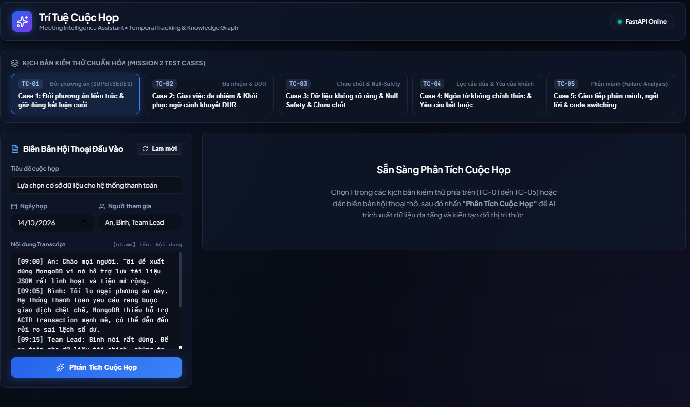
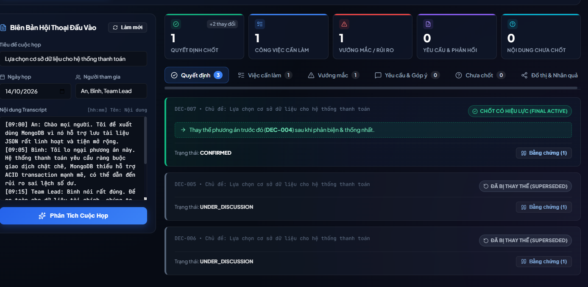
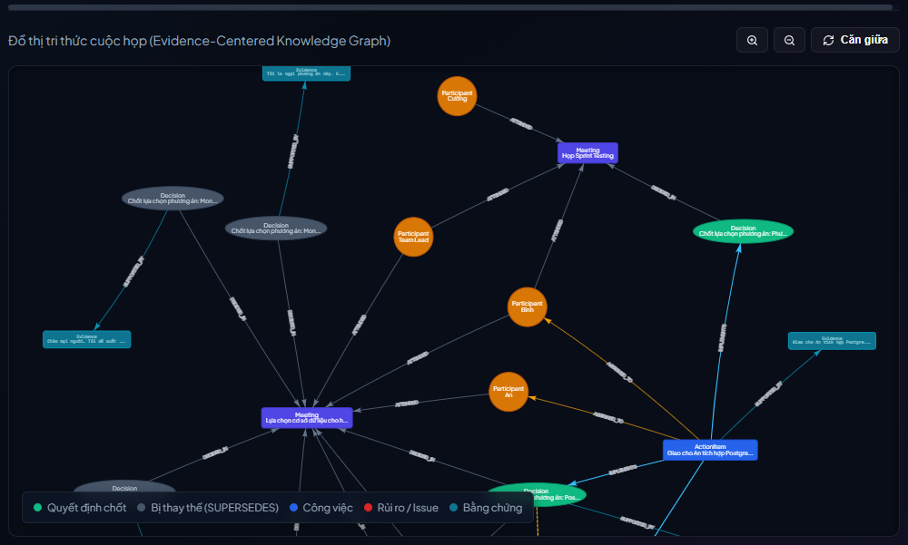
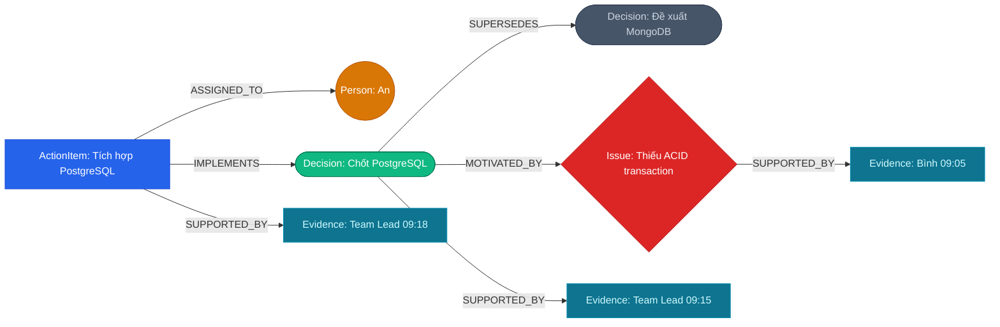
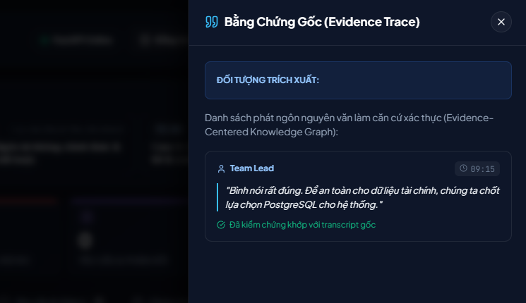
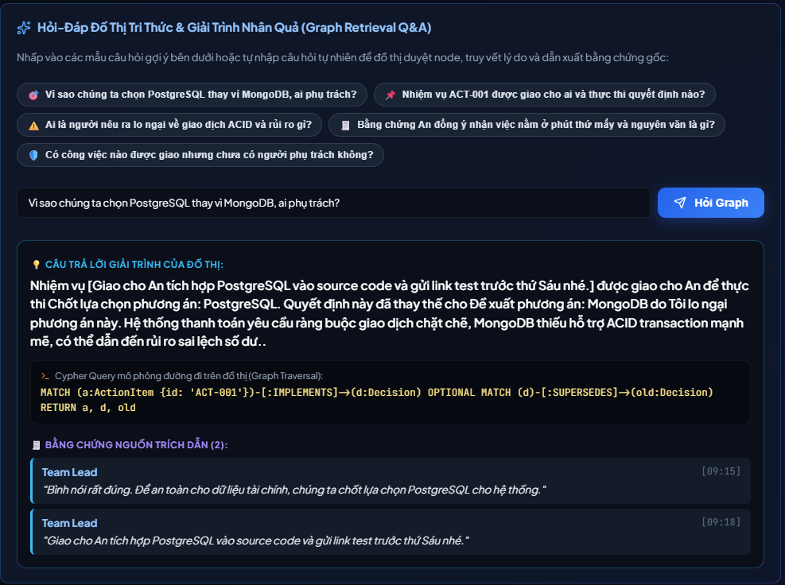

# 🚀 TRÍ TUỆ CUỘC HỌP (Meeting Intelligence Assistant)
### *Evidence-Centered Meeting Knowledge Graph & Temporal Decision Tracking System*

<p align="center">
  <a href="https://meeting-intelligence-graph-geqz.vercel.app/" target="_blank">
    
  </a>
  <a href="https://github.com/nghiemmmm/Meeting-Intelligence-Graph" target="_blank">
    
  </a>
  
  
  
</p>

> 🌐 **TRẢI NGHIỆM TRỰC TIẾP TRÊN WEB (LIVE DEMO):**  
> 👉 **[https://meeting-intelligence-graph-geqz.vercel.app/](https://meeting-intelligence-graph-geqz.vercel.app/)**  
> *(Ứng dụng Web Dashboard + Backend FastAPI Serverless đang hoạt động trực tuyến 24/7 trên hạ tầng Vercel)*

---

Hệ thống AI xử lý biên bản cuộc họp đa tầng, chuyển hóa transcript hội thoại thô thành **dữ liệu cấu trúc có thể tiếp tục sử dụng** cho quy trình vận hành và kiến tạo **Đồ thị tri thức doanh nghiệp (Enterprise Knowledge Graph)**.

Dự án hiện thực hóa trọn vẹn yêu cầu **MISSION 1 (Kiến trúc giải pháp)** và **MISSION 2 (Hiện thực hóa Prototype/MVP)** với khả năng truy vết chuỗi nhân quả, theo dõi thay đổi quyết định theo thời gian (`SUPERSEDES`), khôi phục phát ngôn khuyết ngữ cảnh (`DUR`), và kiểm toán bằng chứng gốc chống ảo giác (`Zero Hallucination`).



---

## 🌟 1. Các Tính Năng Cốt Lõi (Core Capabilities)

### 1.1. Trích xuất 5 Nhóm Thông Tin Cấu Trúc
1. 🎯 **Quyết định (Decisions)**: Nhận diện các kết luận, phương án được chốt, lưu vết trạng thái vòng đời (`CONFIRMED`, `SUPERSEDED`, `UNDER_DISCUSSION`).
2. 📌 **Công việc (Action Items)**: Kèm người chịu trách nhiệm (`assignee`), thời hạn (`deadline`), mức độ ưu tiên (`HIGH / MEDIUM / LOW`) và câu hành động tự thân độc lập (**DUR**).
3. ⚠️ **Vướng mắc / Rủi ro (Issues & Objections)**: Các rủi ro kỹ thuật, phản biện kiến trúc, lo ngại chi phí hoặc xung đột tiến độ.
4. 💬 **Yêu cầu & Phản hồi (Requirements & Feedbacks)**: Đòi hỏi bắt buộc từ khách hàng/stakeholder hoặc đóng góp cải tiến tính năng.
5. ❓ **Nội dung chưa chốt (Unresolved Topics)**: Những vấn đề chưa đạt được đồng thuận, các luồng ý kiến xung đột cần đưa vào nghị trình cuộc họp tiếp theo.

### 1.2. Cơ chế Temporal Decision Tracking (`SUPERSEDES`)
Tự động giải quyết thách thức kinh điển trong biên bản họp: **"Đầu cuộc họp đề xuất phương án A, thảo luận phản biện, cuối cuộc họp chốt phương án B"**.

* **Event Sourcing Model**: Lưu giữ toàn bộ lịch sử thảo luận thay vì ghi đè thô bạo.
* **Cập nhật vòng đời**: Phương án ban đầu được chuyển sang trạng thái `SUPERSEDED` và trỏ liên kết đến quyết định mới qua quan hệ `SUPERSEDES`. Quyết định cuối cùng được gán nhãn `FINAL ACTIVE`.



---

## 🕸️ 2. Đồ Thị Tri Thức Cuộc Họp (Evidence-Centered Knowledge Graph)

Hệ thống xây dựng đồ thị tri thức dựa trên cấu trúc liên kết chặt chẽ giữa các thực thể thảo luận và bằng chứng gốc trong transcript. Đồ thị được quản lý in-memory bằng **NetworkX** và đồng bộ trực tiếp lên cơ sở dữ liệu đồ thị đám mây **Neo4j AuraDB**.



### 2.1. Bản Thể Học Đồ Thị (Graph Ontology & Schema)

Đồ thị bao gồm 7 loại Node thực thể và 6 loại Edge quan hệ có hướng:

| Loại Thực Thể (Node Label) | Biểu Tượng & Màu Sắc | Ý Nghĩa Trong Cuộc Họp |
| :--- | :--- | :--- |
| **`Meeting`** | 🟣 Tím (`#4f46e5`) | Phiên họp (tiêu đề, ngày họp, mã định danh) |
| **`Participant`** | 🟠 Hổ phách (`#d97706`) | Thành viên tham dự hoặc người được phân công nhiệm vụ |
| **`Decision`** | 🟢 Xanh lục (`#10b981`) / ⚪ Xám (`#475569`) | Quyết định chốt có hiệu lực (`FINAL ACTIVE`) hoặc đã bị thay thế (`SUPERSEDED`) |
| **`ActionItem`** | 🔵 Xanh dương (`#2563eb`) | Công việc cần làm (kèm câu DUR độc lập và hạn chót) |
| **`Issue`** | 🔴 Đỏ kim cương (`#dc2626`) | Khó khăn, vướng mắc kỹ thuật hoặc luận điểm phản biện |
| **`Evidence`** | 🔷 Cyan (`#0e7490`) | Bằng chứng gốc: trích dẫn câu nói nguyên văn kèm mốc thời gian |
| **`UnresolvedTopic`** | 💠 Xanh ngọc (`#0891b2`) | Chủ đề chưa thống nhất cần theo dõi tiếp |

#### Các Mối Quan Hệ Giữa Các Thực Thể (Graph Edges):
* `(ActionItem) --[ASSIGNED_TO]--> (Participant)`: Giao nhiệm vụ cho nhân sự phụ trách.
* `(ActionItem) --[IMPLEMENTS]--> (Decision)`: Nhiệm vụ phục vụ cho quyết định cụ thể nào.
* `(Decision: Active) --[SUPERSEDES]--> (Decision: Old)`: Quyết định mới thay thế phương án cũ do diễn biến thảo luận.
* `(Decision) --[MOTIVATED_BY]--> (Issue)`: Quyết định được thúc đẩy/thay đổi do vướng mắc hoặc phản biện nào.
* `(Decision / Action / Issue) --[SUPPORTED_BY]--> (Evidence)`: Liên kết thực thể với phát ngôn nguyên văn.
* `(Participant) --[ATTENDED]--> (Meeting)`: Thành viên tham gia phiên họp.
* `(Decision) --[DECIDED_IN]--> (Meeting)`: Quyết định được đưa ra trong phiên họp nào.

### 2.2. Chuỗi Nhân Quả Đa Chặng (Causal Chain Flow)

Từ bất kỳ nhiệm vụ nào (`ActionItem`), đồ thị cho phép truy vết ngược toàn bộ chuỗi nhân quả ra quyết định:



---

## 🔍 3. Truy Vết Bằng Chứng Gốc & Chống Ảo Giác (Evidence Traceability)

Hệ thống tuân thủ nguyên tắc **Zero Hallucination**: Bất kỳ trích xuất nào cũng phải được chứng minh bằng nguồn gốc trong transcript:

* **Mốc thời gian chính xác**: Gắn nhãn `[hh:mm]` và tên người nói cho từng câu trích dẫn.
* **Ngăn kéo Bằng Chứng Gốc (Evidence Drawer)**: Người dùng có thể bấm vào nút **"Bằng chứng"** ở bất kỳ thẻ quyết định hay nhiệm vụ nào để mở ngăn kéo trượt, đối chiếu câu phát ngôn nguyên văn so với transcript gốc.



---

## 💬 4. Hỏi-Đáp Tri Thức Đồ Thị & Kiểm Toán Nhân Quả (Graph Retrieval Q&A)

Hệ thống tích hợp công cụ **Graph Retrieval Q&A** cho phép người dùng đặt câu hỏi tự nhiên để đồ thị tự động duyệt đường đi và giải trình:



### 4.1. Khả Năng Nổi Bật:
1. **Giải trình lý do ra quyết định**: Tự động giải thích nguyên nhân thay đổi phương án (ví dụ: *Vì sao chọn PostgreSQL thay vì MongoDB?*).
2. **Mô phỏng truy vấn Cypher (Graph Traversal)**: Xuất câu lệnh truy vấn đồ thị tương ứng, hỗ trợ kiểm toán viên đối chiếu đường đi logic:
   ```cypher
   MATCH (a:ActionItem {id: 'ACT-001'})-[:IMPLEMENTS]->(d:Decision)
   OPTIONAL MATCH (d)-[:SUPERSEDES]->(old:Decision)
   RETURN a, d, old
   ```
3. **Trích dẫn bằng chứng tự động**: Trả về danh sách phát ngôn làm căn cứ xác thực câu trả lời.
4. **Kiểm chứng khẳng định (Fact-Checking & Claim Verification)**: Kiểm tra các phát biểu mang tính mâu thuẫn dựa trên cạnh `SUPERSEDES` và `OPPOSES` của đồ thị.
5. **Đồng bộ Neo4j AuraDB**: Hỗ trợ đẩy đồ thị lên dịch vụ đám mây Neo4j AuraDB và thực thi các câu lệnh Cypher phức tạp qua API `/api/graph/neo4j/cypher`.

---

## ⚙️ 5. Cấu Hình Biến Môi Trường (.env)

Hệ thống sử dụng tệp `.env` để quản lý các thông số kết nối và mô hình AI. Một tệp mẫu chuẩn [`d:/GENTALENT/.env.example`](file:///d:/GENTALENT/.env.example) đã được cung cấp sẵn trong kho mã nguồn.

### 5.1. Khởi Tạo Tệp Cấu Hình
Chạy lệnh sau từ thư mục gốc của dự án để tạo tệp `.env`:

```powershell
# Trên Windows PowerShell:
copy .env.example .env

# Hoặc trên Linux / macOS:
cp .env.example .env
```

### 5.2. Bảng Tra Cứu Các Biến Môi Trường

| Tên Biến | Ý Nghĩa & Mô Tả | Giá Trị Mặc Định / Ví Dụ | Phân Loại |
| :--- | :--- | :--- | :--- |
| `OPENAI_API_KEY` | Khóa API truy cập dịch vụ OpenAI | `sk-proj-...` | *Tùy chọn* (Hỗ trợ Offline Fallback) |
| `GEMINI_API_KEY` | Khóa API truy cập dịch vụ Google Gemini | `AIzaSy...` | *Tùy chọn* (Hỗ trợ Offline Fallback) |
| `DEFAULT_LLM_MODEL` | Tên mô hình AI được ưu tiên sử dụng | `gpt-4o-mini` *(hoặc gemini-1.5-flash)* | Mặc định: `gpt-4o-mini` |
| `HOST` | Địa chỉ IP máy chủ Backend FastAPI | `127.0.0.1` | Mặc định: `127.0.0.1` |
| `PORT` | Cổng dịch vụ Backend | `8000` | Mặc định: `8000` |
| `ENVIRONMENT` | Môi trường triển khai (`development` / `production`) | `development` | Mặc định: `development` |
| `PROJECT_NAME` | Tiêu đề dự án hiển thị trên tài liệu Swagger UI | `"Meeting Intelligence Assistant API"` | Tùy biến |
| `VERSION` | Phiên bản phát hành hệ thống | `"1.0.0"` | Tùy biến |
| `NEO4J_URI` | Địa chỉ kết nối đồ thị đám mây Neo4j AuraDB hoặc Bolt | `neo4j+s://your-id.databases.neo4j.io` | *Tùy chọn* (Mặc định dùng NetworkX) |
| `NEO4J_USERNAME` | Tên người dùng cơ sở dữ liệu Neo4j | `neo4j` | Mặc định: `neo4j` |
| `NEO4J_PASSWORD` | Mật khẩu tài khoản Neo4j AuraDB | `your_password_here` | *Tùy chọn* |
| `NEO4J_DATABASE` | Tên database trên Neo4j | `neo4j` | Mặc định: `neo4j` |
| `AURA_INSTANCEID` | Mã định danh Instance trên Neo4j Aura console | `c842b142` | *Tùy chọn* |
| `AURA_INSTANCENAME` | Tên phiên bản hiển thị của Instance | `"Instance 1"` | *Tùy chọn* |

### 5.3. Cơ Chế Zero-Config Offline Fallback (Không Cần API Key)
> [!TIP]
> **Khả năng chạy độc lập 100%**: Nếu bạn **không cung cấp bất kỳ API key nào** trong `.env`, hệ thống sẽ **không báo lỗi**. Thay vào đó, backend tự động chuyển đổi sang cơ chế **Heuristic Rule-Based NLP Extractor** và lưu trữ đồ thị thuần túy trên bộ nhớ RAM bằng **NetworkX**.
> Bạn có thể clone dự án về và chạy thử nghiệm ngay lập tức mà không cần tài khoản cloud hay trả phí API.

---

## ⚡ 6. Hướng Dẫn Cài Đặt & Khởi Chạy

### Cách 1: Khởi Chạy Trọn Gói (Backend FastAPI + Web Dashboard)
Giao diện React hiện đại đã được build sẵn vào thư mục `frontend/dist` và được FastAPI phục vụ trực tiếp:

```powershell
# 1. Kích hoạt môi trường ảo Python (tại thư mục d:\GENTALENT)
.\venv\Scripts\Activate.ps1

# 2. Khởi chạy máy chủ
.\venv\Scripts\uvicorn main:app --reload --host 127.0.0.1 --port 8000
```

* 🌐 **Web Dashboard SPA**: Mở trình duyệt tại **[http://127.0.0.1:8000/](http://127.0.0.1:8000/)**
* 📖 **Tài liệu API Tương Tác (Swagger UI)**: [http://127.0.0.1:8000/docs](http://127.0.0.1:8000/docs)
* 🩺 **Kiểm Tra Trạng Thái Hệ Thống (Healthcheck)**: [http://127.0.0.1:8000/health](http://127.0.0.1:8000/health)

### Cách 2: Khởi Chạy Môi Trường Phát Triển Frontend (Vite Hot-Reload)
Dành cho việc chỉnh sửa và phát triển giao diện:

```powershell
# Terminal 1: Chạy Backend FastAPI
.\venv\Scripts\uvicorn main:app --reload --host 127.0.0.1 --port 8000

# Terminal 2: Chạy Frontend Vite
cd frontend
npm run dev
```
Mở trình duyệt tại **[http://localhost:5173/](http://localhost:5173/)** (Vite tự động proxy các yêu cầu API về cổng 8000).

### Cách 3: Trải Nghiệm Trực Tiếp Trên Vercel (Live Cloud Demo)

Hệ thống đã được đóng gói và triển khai trực tuyến trên hạ tầng đám mây Vercel:

* 🌐 **Website Ứng Dụng (Web Dashboard SPA)**: **[https://meeting-intelligence-graph-geqz.vercel.app/](https://meeting-intelligence-graph-geqz.vercel.app/)**
* 🩺 **Kiểm Tra Trạng Thái API (Healthcheck Online)**: [https://meeting-intelligence-graph-geqz.vercel.app/health](https://meeting-intelligence-graph-geqz.vercel.app/health)
* 📖 **Tài Liệu API Tương Tác (Swagger UI Online)**: [https://meeting-intelligence-graph-geqz.vercel.app/docs](https://meeting-intelligence-graph-geqz.vercel.app/docs)

---

## 🧪 7. Bộ Kiểm Thử Tự Động (Mission 2 Test Suite)

Hệ thống được kiểm chứng qua bộ kiểm thử tự động gồm 05 tình huống thực chiến:

```powershell
.\venv\Scripts\python tests/test_mission2_suite.py
```

### Kết Quả Đánh Giá:
| Mã Kịch Bản | Nội Dung Tình Huống Kiểm Thử | Phân Loại Đánh Giá | Kết Quả |
| :--- | :--- | :--- | :--- |
| **TC-01** | Đổi phương án kiến trúc & giữ đúng kết luận cuối (`SUPERSEDES`) | `SUCCESS_STABLE` | **ĐẠT (PASS)** |
| **TC-02** | Giao việc đa nhiệm & Khôi phục ngữ cảnh khuyết (`DUR`) | `SUCCESS_STABLE` | **ĐẠT (PASS)** |
| **TC-03** | Dữ liệu không rõ ràng, Null-Safety & Nội dung chưa chốt | `EDGE_UNRESOLVED` | **ĐẠT (PASS)** |
| **TC-04** | Ngôn từ thân mật, nói đùa & Yêu cầu bắt buộc từ khách hàng | `COMPLEX_OBJECTION` | **ĐẠT (PASS)** |
| **TC-05** | Giao tiếp phân mảnh, ngắt lời & Code-switching tiếng Anh/Việt | `FAILURE_ANALYSIS` | **ĐẠT ĐÚNG GIẢ THUYẾT THẤT BẠI** |

Chi tiết báo cáo kiểm thử định dạng chuẩn *Kỳ vọng → Thực tế → Đạt/Chưa đạt → Điều học được* được lưu trữ tại [BAO_CAO_KIEM_THU_MISSION_2.md](file:///d:/GENTALENT/BAO_CAO_KIEM_THU_MISSION_2.md).

### Kiểm Thử Toàn Diện Tích Hợp API:
```powershell
.\venv\Scripts\python tests/test_api_endpoints.py
```
Toàn bộ 8 nhóm API (Health, Meetings Process, Actions, Causal Chain, Decisions, Insights, Graph Subgraph, Graph Q&A) đều vượt qua 100%.
