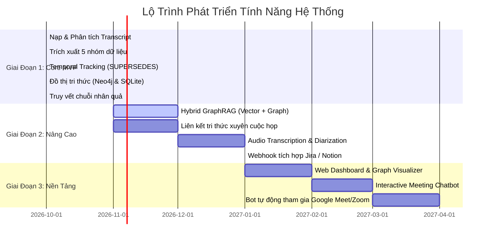

# 📋 DANH SÁCH TÍNH NĂNG & LỘ TRÌNH PHÁT TRIỂN (FEATURE ROADMAP)
## Dự Án: Trí Tuệ Cuộc Họp (Meeting Intelligence Assistant)

Tài liệu này tổng hợp toàn bộ các tính năng cốt lõi (Core Features), tính năng nâng cao (Advanced Features) và lộ trình phát triển sản phẩm từ giai đoạn **Prototype / MVP (Mission 2)** đến **Nền tảng Doanh nghiệp (Enterprise Platform)**.

---

## 🎯 Tổng Quan Ma Trận Phân Bổ Tính Năng (Feature Matrix)

---

## 🟢 GIAI ĐOẠN 1: TÍNH NĂNG CỐT LÕI (CORE MVP — ĐÃ HOÀN THÀNH 100%)

> Mục tiêu: Chứng minh tính khả thi của giải pháp, giải quyết trọn vẹn yêu cầu của **Mission 1** và **Mission 2**.

### 1.1. Ingestion & Structured Parsing
* **Mã**: `FEAT-01`
* **Mô tả**: Tiếp nhận biên bản transcript cuộc họp theo cấu trúc phân lượt nói (`speaker`, `timestamp`, `text`).
* **Kỹ thuật**: FastAPI Pydantic v2 validation, hỗ trợ format JSON chuẩn hóa.
* **Trạng thái**: ✅ **Hoàn thành 100%** (`POST /api/meetings/process`).

### 1.2. Trích Xuất 5 Nhóm Thông Tin Cốt Lõi (5-Group Information Extraction)
* **Mã**: `FEAT-02`
* **Mô tả**: Bóc tách chính xác và độc lập 5 nhóm dữ liệu nghiệp vụ:
  1. 🎯 **Quyết định (Decisions)**: Nhận diện nội dung chốt, trạng thái vòng đời.
  2. 📌 **Công việc cần làm (Action Items)**: Nhiệm vụ, người làm, hạn chót.
  3. ⚠️ **Vướng mắc / Vấn đề (Issues / Blockers)**: Trở ngại kỹ thuật, phản biện, rủi ro tài chính.
  4. 💬 **Yêu cầu & Phản hồi (Requirements & Feedbacks)**: Yêu cầu của khách hàng/stakeholder.
  5. ❓ **Nội dung chưa chốt (Unresolved Topics)**: Bất đồng đang bỏ ngỏ cần thảo luận tiếp.
* **Kỹ thuật**: OpenAI Structured Outputs kết hợp Heuristic Rule-based Fallback Parser.
* **Trạng thái**: ✅ **Hoàn thành 100%**.

### 1.3. Theo Dõi Thay Đổi Quyết Định (Temporal Decision Tracking)
* **Mã**: `FEAT-03`
* **Mô tả**: Tự động nhận diện tình huống *Đầu cuộc họp đề xuất phương án A, cuối cuộc họp chốt phương án B*. Gắn nhãn `SUPERSEDED` cho phương án cũ, giữ `is_final_active=True` cho phương án mới.
* **Kỹ thuật**: Event Sourcing model (`DecisionEvent`), quan hệ đồ thị `SUPERSEDES`.
* **Trạng thái**: ✅ **Hoàn thành 100%** (`GET /api/decisions/final`).

### 1.4. Khôi Phục Ngữ Cảnh Khuyết (DUR) & Null-Safety Chống Ảo Giác
* **Mã**: `FEAT-04`
* **Mô tả**: 
  - Khôi phục câu văn độc lập ngữ cảnh (De-contextualization), bổ sung chủ ngữ/vị ngữ bị khuyết trong hội thoại nói nhanh.
  - Áp dụng nguyên tắc **Null-Safety**: Nếu người làm hoặc deadline không được nêu đích danh, giữ nguyên `null`, tuyệt đối không để LLM bịa đặt.
* **Trạng thái**: ✅ **Hoàn thành 100%**.

### 1.5. Đối Chiếu Bằng Chứng Gốc (Evidence Grounding)
* **Mã**: `FEAT-05`
* **Mô tả**: Mọi thực thể trích xuất (Decision, Action, Issue, Requirement) đều gắn kèm bằng chứng trích dẫn nguyên văn (`quote_text`), người nói (`speaker`) và mốc thời gian (`timestamp`).
* **Trạng thái**: ✅ **Hoàn thành 100%** (`evidence_list`).

### 1.6. Lưu Trữ Kép Bền Vững (Hybrid Persistence: Neo4j AuraDB & SQLite)
* **Mã**: `FEAT-06`
* **Mô tả**:
  - **Neo4j AuraDB (Cloud)**: Lưu trữ Đồ thị tri thức (Knowledge Graph) phục vụ duyệt quan hệ đa bước.
  - **SQLite (`data/meetings.db`)**: Lưu trữ quan hệ 6 bảng, đảm bảo dữ liệu không bị mất sau khi tắt server.
* **Trạng thái**: ✅ **Hoàn thành 100%**.

### 1.7. Truy Vết Chuỗi Nhân Quả (Causal Chain Traversal API)
* **Mã**: `FEAT-07`
* **Mô tả**: Trả lời câu hỏi: *"Vì sao giao nhiệm vụ ACT-001, xuất phát từ quyết định nào, do ai phản biện và bằng chứng ở phút nào?"*.
* **Kỹ thuật**: Graph traversal lần theo các cạnh: `ActionItem ➔ IMPLEMENTS ➔ Decision ➔ SUPERSEDES ➔ OldDecision ➔ MOTIVATED_BY ➔ Issue ➔ SUPPORTED_BY ➔ Evidence`.
* **Trạng thái**: ✅ **Hoàn thành 100%** (`GET /api/actions/{action_id}/causal-chain`).

---

## 🟡 GIAI ĐOẠN 2: TÍNH NĂNG MỞ RỘNG (ADVANCED INTELLIGENCE — ĐỀ XUẤT TIẾP THEO)

> Mục tiêu: Tăng cường chiều sâu xử lý ngôn ngữ tự nhiên, mở rộng kho tri thức liên cuộc họp và kết nối quy trình doanh nghiệp.

### 2.1. Phân Tích & Liên Kết Tri Thức Xuyên Cuộc Họp (Cross-Meeting Knowledge Linking)
* **Mã**: `FEAT-08` | **Ưu tiên**: `P0`
* **Mô tả**: Kết nối diễn biến giữa nhiều cuộc họp theo thời gian:
  * Cuộc họp 1 (Thứ Hai): Đưa ra quyết định và giao nhiệm vụ.
  * Cuộc họp 2 (Thứ Sáu): Kiểm tra tiến độ nhiệm vụ đó, thảo luận phát sinh sự cố.
  * Cuộc họp 3 (Tuần sau): Thay đổi quyết định đã chốt từ cuộc họp 1.
* **Kỹ thuật**: Cạnh đồ thị liên cuộc họp `(Decision:Meeting2)-[:MODIFIES]->(Decision:Meeting1)` và `(ActionItem)-[:RESOLVED_IN]->(Meeting2)`.

### 2.2. Tìm Kiếm Ngữ Nghĩa Kết Hợp Đồ Thị (Hybrid GraphRAG)
* **Mã**: `FEAT-09` | **Ưu tiên**: `P0`
* **Mô tả**: Kết hợp Vector Database (ChromaDB / pgvector / Qdrant) với Neo4j:
  * Vector Search: Tìm nhanh các đoạn phát ngôn tương đồng ngữ nghĩa.
  * Graph Traversal: Mở rộng các node lân cận để lấy toàn bộ bối cảnh và nguyên nhân.
* **Kỹ thuật**: Local Search & Global Search theo nghiên cứu của Microsoft Research GraphRAG.

### 2.3. Tự Động Chuyển Audio/Video Sang Transcript (Audio Diarization & ASR)
* **Mã**: `FEAT-10` | **Ưu tiên**: `P1`
* **Mô tả**: Cho phép người dùng tải lên file âm thanh (`.mp3`, `.m4a`, `.wav`) hoặc video (`.mp4`):
  * Tự động tách giọng người nói (Speaker Diarization bằng PyAnnote).
  * Tự động chuyển giọng nói thành văn bản tiếng Việt có dấu (OpenAI Whisper / Google Speech-to-Text).
* **Kỹ thuật**: Async Worker queue (Celery / Redis / BackgroundTasks) xử lý audio ngầm.

### 2.4. Tích Hợp Đồng Bộ Quy Trình Công Việc (Workflow Webhook Integrations)
* **Mã**: `FEAT-11` | **Ưu tiên**: `P1`
* **Mô tả**: Đẩy trực tiếp các Action Items sau khi chốt cuộc họp sang các công cụ quản lý dự án:
  * Tạo ticket trên **Jira / Linear**.
  * Tạo card trên **Trello**.
  * Tạo hàng trong cơ sở dữ liệu **Notion**.
  * Gửi tóm tắt công việc vào kênh chat **Slack / Microsoft Teams / Telegram**.

### 2.5. Xuất Báo Cáo & Biên Bản Họp Tự Động (Automated Meeting Minutes Export)
* **Mã**: `FEAT-12` | **Ưu tiên**: `P2`
* **Mô tả**: Cho phép tải về biên bản họp đã được ký duyệt ảo với các định dạng:
  * Xuất file **PDF** chuyên nghiệp có logo doanh nghiệp, bảng việc, người ký nhận.
  * Xuất file **Markdown / Word (.docx)**.
  * Tự động gửi Email Digest cho toàn bộ người tham gia cuộc họp.

---

## 🔵 GIAI ĐOẠN 3: NỀN TẢNG DOANH NGHIỆP & GIAO DIỆN NGƯỜI DÙNG (ENTERPRISE PLATFORM)

> Mục tiêu: Đóng gói thành sản phẩm SaaS/Enterprise hoàn chỉnh phục vụ người dùng cuối không chuyên kỹ thuật.

### 3.1. Giao Diện Web Dashboard Tương Tác (Interactive Web UI)
* **Mã**: `FEAT-13` | **Ưu tiên**: `P0`
* **Mô tả**:
  * **Graph Visualizer**: Xem đồ thị cuộc họp trực quan với các node màu sắc sinh động (vis.js hoặc Cytoscape.js).
  * **Timeline View**: Xem dòng thời gian diễn biến cuộc họp từ lúc đề xuất đến lúc chốt.
  * **Action Items Kanban**: Bảng Kanban kéo thả trạng thái công việc (To Do, In Progress, Done).

### 3.2. Trợ Lý AI Chatbot Hội Thoại (Meeting AI Co-Pilot Chatbot)
* **Mã**: `FEAT-14` | **Ưu tiên**: `P0`
* **Mô tả**: Hộp chat thông minh trả lời mọi câu hỏi về lịch sử họp của công ty:
  * *"Tuần trước phòng kỹ thuật đã thống nhất dùng framework gì?"*
  * *"Anh An có những task nào sắp đến deadline trước thứ Sáu?"*
  * *"Những vấn đề nào của khách hàng vẫn chưa được chốt?"*

### 3.3. Bot Tự Động Tham Gia Cuộc Họp Trực Tuyến (Virtual Meeting Bot)
* **Mã**: `FEAT-15` | **Ưu tiên**: `P2`
* **Mô tả**:
  * Tích hợp Google Calendar / Outlook: Tự động phát hiện lịch họp.
  * Bot tự động join vào **Google Meet**, **Zoom**, **Microsoft Teams**, ghi âm và gửi biên bản sau khi cuộc họp kết thúc 5 phút.

### 3.4. Hệ Thống Cảnh Báo Sớm Mâu Thuẫn & Rủi Ro (Conflict & Risk Early Warning)
* **Mã**: `FEAT-16` | **Ưu tiên**: `P1`
* **Mô tả**:
  * **Xung đột quyết định**: Phát hiện quyết định ở cuộc họp này mâu thuẫn với chính sách hoặc quyết định ở cuộc họp trước.
  * **Quá tải nhiệm vụ**: Cảnh báo một cá nhân bị giao quá nhiều việc gấp trong cùng một khoảng thời gian.
  * **Trùng lặp công việc**: Phát hiện 2 người ở 2 phòng ban cùng được giao một đầu việc tương tự nhau.

### 3.5. Bảo Mật Doanh Nghiệp & Phân Quyền (RBAC & Multi-Tenancy)
* **Mã**: `FEAT-17` | **Ưu tiên**: `P1`
* **Mô tả**:
  * Phân quyền theo phòng ban: Chỉ người thuộc Ban Giám đốc mới xem được biên bản họp chiến lược/tài chính.
  * Hỗ trợ chuẩn xác thực Single Sign-On (SSO / OAuth2).
  * Mã hóa dữ liệu transcript và kiểm toán truy cập (Audit Logs).

---

## 📊 BẢNG TỔNG KẾT TIẾN ĐỘ TÍNH NĂNG

| Mã Feature | Tên Tính Năng | Giai Đoạn | Độ Ưu Tiên | Trạng Thái Hiện Tại |
| :--- | :--- | :---: | :---: | :---: |
| `FEAT-01` | Ingestion & Structured Parsing | Pha 1 | `P0` | ✅ **Đã hoàn thành (100%)** |
| `FEAT-02` | Trích xuất 5 nhóm dữ liệu cốt lõi | Pha 1 | `P0` | ✅ **Đã hoàn thành (100%)** |
| `FEAT-03` | Temporal Decision Tracking (`SUPERSEDES`) | Pha 1 | `P0` | ✅ **Đã hoàn thành (100%)** |
| `FEAT-04` | Khôi phục ngữ cảnh (DUR) & Null-Safety | Pha 1 | `P0` | ✅ **Đã hoàn thành (100%)** |
| `FEAT-05` | Đối chiếu bằng chứng gốc (Evidence Linking) | Pha 1 | `P0` | ✅ **Đã hoàn thành (100%)** |
| `FEAT-06` | Lưu trữ kép (Neo4j AuraDB & SQLite) | Pha 1 | `P0` | ✅ **Đã hoàn thành (100%)** |
| `FEAT-07` | Truy vết chuỗi nhân quả (Causal Chain Traversal) | Pha 1 | `P0` | ✅ **Đã hoàn thành (100%)** |
| `FEAT-08` | Liên kết tri thức xuyên cuộc họp | Pha 2 | `P0` | 🔄 *Sẵn sàng triển khai* |
| `FEAT-09` | Hybrid GraphRAG (Vector + Graph) | Pha 2 | `P0` | 🔄 *Sẵn sàng triển khai* |
| `FEAT-10` | Audio Diarization & Whisper ASR | Pha 2 | `P1` | 📅 *Kế hoạch Pha 2* |
| `FEAT-11` | Webhook Jira / Trello / Notion | Pha 2 | `P1` | 📅 *Kế hoạch Pha 2* |
| `FEAT-12` | Xuất biên bản họp PDF / Markdown | Pha 2 | `P2` | 📅 *Kế hoạch Pha 2* |
| `FEAT-13` | Web Dashboard & Graph Visualizer | Pha 3 | `P0` | 📅 *Kế hoạch Pha 3* |
| `FEAT-14` | Trợ lý AI Chatbot tương tác | Pha 3 | `P0` | 📅 *Kế hoạch Pha 3* |
| `FEAT-15` | Bot tự động join Google Meet / Zoom | Pha 3 | `P2` | 📅 *Kế hoạch Pha 3* |
| `FEAT-16` | Cảnh báo sớm mâu thuẫn & quá tải task | Pha 3 | `P1` | 📅 *Kế hoạch Pha 3* |
| `FEAT-17` | Phân quyền RBAC & Bảo mật doanh nghiệp | Pha 3 | `P1` | 📅 *Kế hoạch Pha 3* |
