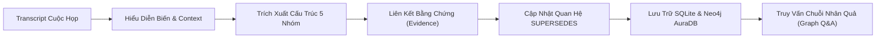

# 🎯 MỤC TIÊU THỰC HIỆN MISSION 2 — HIỆN THỰC HÓA PROTOTYPE / MVP

> **Đề bài & Thách thức**: Doanh nghiệp cần một sản phẩm sử dụng AI để biến nội dung cuộc họp thành dữ liệu có cấu trúc có thể tiếp tục sử dụng cho công việc, quy trình và kho tri thức. Thách thức cốt lõi không phải chỉ là tóm tắt văn bản, mà là **hiểu đúng diễn biến cuộc họp**, liên kết **bằng chứng gốc (Evidence)**, và xác định chính xác **thông tin nào thực sự có giá trị sau khi cuộc họp kết thúc** (đặc biệt là xử lý tình huống ý kiến ban đầu thay đổi trong quá trình họp).

---

## 📌 1. Câu Hỏi Cốt Lõi & Định Hướng Giải Pháp

> *"Làm thế nào để sau mỗi cuộc họp, những thông tin quan trọng được ghi nhận đúng, không bị ảo giác và có thể tiếp tục sử dụng cho công việc?"*

### Triết lý hiện thực hóa Mission 2:
1. **Tập trung vào phần quan trọng nhất (Proof of Concept)**: Không dàn trải tính năng thừa, tập trung chứng minh giả thuyết cốt lõi bằng sản phẩm chạy được thực tế.
2. **Không phá hủy lịch sử (Non-destructive Event Sourcing)**: Khi phương án A bị bác bỏ và chuyển sang phương án B, không xóa phương án A mà gắn nhãn `SUPERSEDED` và tạo liên kết quan hệ trong Knowledge Graph.
3. **Chống ảo giác nghiêm ngặt (Null-Safety)**: Nếu phát ngôn mơ hồ không chỉ định người làm hoặc thời hạn, để `null` thay vì để LLM tự suy đoán.
4. **Lưu trữ đa tầng (Hybrid Persistence)**: Kết hợp **Neo4j AuraDB** (truy vết đồ thị nhân quả) và **SQLite** (lưu trữ bảng biểu bền vững).

---

## 🔄 2. Core Loop Mission 2



### Các nhóm thông tin cốt lõi bắt buộc:
1. 🎯 **Quyết định (Decisions)**:
   - Theo dõi sự đồng thuận, trạng thái vòng đời (`CONFIRMED`, `SUPERSEDED`).
   - Cờ `is_final_active`: Xác định quyết định có hiệu lực thi hành cuối cùng sau khi cuộc họp kết thúc.
2. 📌 **Công việc cần làm (Action Items)**:
   - Người chịu trách nhiệm (`assignee`), hạn chót (`deadline_raw`), mức độ ưu tiên (`priority`).
   - Kỹ thuật De-contextualization (DUR): Tái tạo câu văn độc lập, khôi phục chủ ngữ/vị ngữ khuyết.
3. ⚠️ **Vướng mắc / Vấn đề (Issues / Blockers)**:
   - Khó khăn kỹ thuật, lo ngại chi phí, rủi ro tiến độ, mức độ nghiêm trọng (`severity`).
4. 💬 **Yêu cầu & Phản hồi (Requirements & Feedbacks)**:
   - Yêu cầu bắt buộc từ khách hàng/stakeholder hoặc feedback sản phẩm.
5. ❓ **Nội dung chưa được chốt (Unresolved Topics)**:
   - Vấn đề đang tranh luận bỏ ngỏ, câu hỏi mở cần đưa vào nghị trình cuộc họp sau.
6. 🧾 **Bằng chứng gốc (Evidence Linking)**:
   - Mọi thực thể trích xuất đều có danh sách `evidence_list` chứa `speaker`, `timestamp`, `quote_text`.

---

## ⚡ 3. Tình Huống Bắt Buộc: Ý Kiến Ban Đầu Thay Đổi

* **Kịch bản thực tế**:
  * Phút `09:00`: Thành viên đề xuất phương án A (*MongoDB*).
  * Phút `09:05`: Thành viên khác phản biện rủi ro (*Thiếu ACID transaction cho tài chính*).
  * Phút `09:15`: Trưởng nhóm kết luận chốt phương án B (*PostgreSQL*).
  * Phút `09:18`: Giao việc tích hợp phương án B trước thứ Sáu.
* **Hiện thực hóa trong hệ thống**:
  * Phương án A: Trạng thái chuyển thành `SUPERSEDED`, cờ `is_final_active = False`.
  * Phương án B: Trạng thái `CONFIRMED`, cờ `is_final_active = True`, thuộc tính `supersedes_decision_id = "DEC-001"`.
  * Cạnh đồ thị: `(Decision B)-[:SUPERSEDES]->(Decision A)`.
  * Liên kết nhân quả: `(Decision B)-[:MOTIVATED_BY]->(Issue: "Thiếu ACID transaction")`.
  * Endpoint chuyên biệt: `GET /api/decisions/final` đảm bảo **chỉ trả về phương án B** có hiệu lực cuối cùng.

---

## 🧪 4. Bộ Kiểm Thử Mission 2 (05 Tình Huống Chuẩn Hóa)

Format chuẩn: **Kỳ vọng ➔ Kết quả thực tế ➔ Đạt/Chưa đạt ➔ Điều học được**

| STT | Mã test | Tình huống | Phân loại | Kết quả đánh giá |
| :---: | :---: | :--- | :--- | :---: |
| **1** | `TC-01` | **Đổi phương án kiến trúc & giữ đúng kết luận cuối**<br>*(Đề xuất MongoDB ➔ Phản biện ACID ➔ Chốt PostgreSQL ➔ Giao An)* | `SUCCESS_STABLE`<br>(Làm tốt) | **ĐẠT (PASS)** |
| **2** | `TC-02` | **Giao việc đa nhiệm & Khôi phục ngữ cảnh khuyết DUR**<br>*(Sprint Planning phân công 2 task riêng cho Bình và Cường)* | `SUCCESS_STABLE`<br>(Làm tốt) | **ĐẠT (PASS)** |
| **3** | `TC-03` | **Dữ liệu không rõ ràng & Null-Safety & Nội dung chưa chốt**<br>*(Feedback timeout, tranh luận chưa ngã ngũ, nói bâng quơ không người làm)* | `EDGE_UNRESOLVED`<br>(Khó / Mơ hồ) | **ĐẠT (PASS)** |
| **4** | `TC-04` | **Ngôn từ không chính thức, nói đùa và yêu cầu khách hàng**<br>*(Nói đùa đập đi viết lại Rust, đề xuất Vue nhưng khách bắt buộc React)* | `COMPLEX_OBJECTION`<br>(Nhiễu / Phức tạp) | **ĐẠT (PASS)** |
| **5** | `TC-05` | **Giao tiếp phân mảnh, ngắt lời và code-switching kỹ thuật sâu**<br>*(Hội thoại cắt vụn, nói chồng chéo, khuyết tân ngữ nặng nề)* | `FAILURE_ANALYSIS`<br>(Thất bại dự kiến) | **ĐẠT ĐÚNG GIẢ THUYẾT**<br>(Identified Limitation) |

> 📄 Toàn văn chi tiết báo cáo kiểm thử 5 tình huống được lưu tại file: [BAO_CAO_KIEM_THU_MISSION_2.md](file:///d:/GENTALENT/BAO_CAO_KIEM_THU_MISSION_2.md).

---

## 🏛️ 5. Bản Đồ Hiện Thực Hóa Kỹ Thuật (Architecture Implementation)

```text
d:/GENTALENT/
├── src/
│   ├── api/routes/
│   │   ├── meetings.py          # POST /api/meetings/process, GET /api/meetings
│   │   ├── decisions.py         # GET /api/decisions/final (lấy quyết định cuối cùng)
│   │   ├── actions.py           # GET /api/actions/{id}/causal-chain (chuỗi nhân quả)
│   │   ├── insights.py          # GET /api/insights/issues, /requirements-feedbacks, /unresolved
│   │   └── graph.py             # GET /api/graph/subgraph, /neo4j/stats, POST /cypher
│   ├── db/                      # Cơ sở dữ liệu quan hệ SQLite
│   │   ├── database.py          # Kết nối engine SQLite (data/meetings.db)
│   │   ├── models.py            # 6 bảng ORM: meetings, decisions, action_items,...
│   │   └── repository.py        # Tầng lưu trữ bền vững CRUD
│   ├── services/
│   │   ├── llm_service.py       # OpenAI Structured Outputs & Fallback Heuristic
│   │   ├── tracker_service.py   # Event Sourcing Temporal Decision Tracker
│   │   ├── neo4j_service.py     # Kết nối đám mây Neo4j AuraDB (Live Sync & Cypher)
│   │   ├── graph_service.py     # NetworkX MultiDiGraph & Causal Chain Traversal
│   │   └── pipeline_service.py  # Orchestration Pipeline trích xuất 5 nhóm
│   └── schemas/                 # Pydantic v2 Models chống ảo giác
├── data/
│   ├── meetings.db              # File SQLite Database lưu trữ vĩnh viễn
│   └── test_cases.json          # Dataset 05 tình huống kiểm thử chuẩn hóa
└── tests/
    ├── test_mission2_suite.py   # Runner tự động 5 tình huống kiểm thử Mission 2
    ├── test_api_endpoints.py    # Kiểm thử tích hợp toàn bộ API qua TestClient
    └── test_neo4j_sync.py       # Kiểm thử xác minh trực tiếp trên Neo4j AuraDB
```

---

## ✅ 6. Bảng Đánh Giá Mức Độ Hoàn Thành Mission 2

| Mục tiêu đề bài Mission 2 | Tình trạng | Minh chứng kỹ thuật |
| :--- | :---: | :--- |
| **Xây Prototype/MVP chạy được thực tế** | ✅ 100% | Backend FastAPI với đầy đủ API và Swagger UI tương tác (`/docs`). |
| **Trích xuất 5 nhóm dữ liệu cấu trúc** | ✅ 100% | Đã hiện thực `decisions`, `action_items`, `issues`, `requirements_feedbacks`, `unresolved_topics`. |
| **Liên kết bằng chứng Evidence từ transcript** | ✅ 100% | Schema `Evidence` chứa `quote_text`, `speaker`, `timestamp` gắn vào từng thực thể. |
| **Ý kiến ban đầu thay đổi (SUPERSEDES)** | ✅ 100% | Đã kiểm thử thành công: phương án cũ chuyển `SUPERSEDED`, phương án mới giữ `is_final_active=True`. |
| **Tối thiểu 05 tình huống kiểm thử** | ✅ 100% | Đã thiết lập trong `data/test_cases.json` và chạy qua `tests/test_mission2_suite.py`. |
| **Tình huống làm tốt** | ✅ 100% | TC-01 (Đổi phương án) & TC-02 (Đa nhiệm DUR) đạt 100%. |
| **Tình huống khó / dữ liệu không rõ ràng** | ✅ 100% | TC-03 (Chưa chốt, Null-Safety) & TC-04 (Lọc câu nói đùa, chốt React) đạt 100%. |
| **Tình huống chưa xử lý tốt / thất bại** | ✅ 100% | TC-05 (Phân tích nguyên nhân ngắt lời, khuyết tân ngữ và bài học tích hợp Audio Diarization). |
| **Format đánh giá chuẩn** | ✅ 100% | *Kỳ vọng ➔ Kết quả thực tế ➔ Đạt/Chưa đạt ➔ Điều học được* trong `BAO_CAO_KIEM_THU_MISSION_2.md`. |
| **Lưu trữ dữ liệu tiếp tục sử dụng** | ✅ 100% | Lưu trữ song song trên **Neo4j AuraDB** và **SQLite** (`data/meetings.db`). |

---

## 🚀 7. Lệnh Thực Thi & Kiểm Tra Nhanh

```powershell
# 1. Chạy toàn bộ 5 test cases Mission 2 và xem báo cáo
.\venv\Scripts\python tests/test_mission2_suite.py

# 2. Chạy kiểm thử lưu trữ và truy vấn trên Neo4j AuraDB
.\venv\Scripts\python tests/test_neo4j_sync.py

# 3. Chạy kiểm thử cơ sở dữ liệu SQLite
.\venv\Scripts\python tests/test_sqlite.py

# 4. Khởi chạy FastAPI Server tương tác
.\venv\Scripts\uvicorn main:app --reload --host 127.0.0.1 --port 8000
```