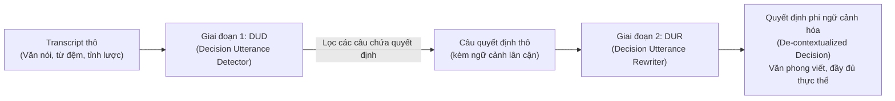

# Nghiên Cứu Tham Chiếu: Meeting Decision Tracker (MDT)

Tài liệu này tổng hợp và phân tích chuyên sâu công trình nghiên cứu về **Meeting Decision Tracker (MDT)** — khung làm việc 2 giai đoạn (*Two-stage Framework*) kinh điển trong việc tự động hóa trích xuất và tái cấu trúc quyết định từ biên bản cuộc họp kinh doanh hàng ngày.

Đây là tài liệu nghiên cứu liên quan (*Related Work / Literature Review*) làm cơ sở khoa học cho hệ thống **Trí Tuệ Cuộc Họp (Meeting Intelligence Assistant)**.

---

## 1. Tổng Quan & Vấn Đề Giải Quyết

### Mục tiêu của MDT
Tự động hóa việc trích xuất và tóm tắt các quyết định từ biên bản cuộc họp kinh doanh (*business meeting transcripts*) thành danh sách các quyết định rõ ràng, có cấu trúc và dễ hiểu khi đọc độc lập.

### Thách thức từ văn phong hội thoại tự nhiên
Các bản ghi chép cuộc họp thường gặp phải các đặc thù ngôn ngữ gây khó khăn cho việc xử lý tự động:
* **Dài dòng & nhiều từ đệm (Disfluency & Fillers):** Chứa nhiều thán từ (*"ừm"*, *"à thì"*, *"nhỉ"*).
* **Thiếu ngữ cảnh độc lập:** Câu nói trong cuộc họp phụ thuộc chặt chẽ vào các lượt nói trước đó.
* **Hiện tượng tỉnh lược (Ellipses):** Người nói thường xuyên lược bỏ chủ ngữ hoặc tân ngữ vì cho rằng người nghe đã ngầm hiểu.
* **Hiện tượng đồng tham chiếu (Co-references):** Sử dụng dày đặc các đại từ thay thế (*"nó"*, *"cái đó"*, *"phương án như anh nói"*).

> Nếu chỉ trích xuất nguyên văn câu nói gốc (*verbatim extraction*), người đọc sẽ không thể hiểu được quyết định nếu không đọc lại toàn bộ biên bản hội thoại xung quanh.

---

## 2. Kiến Trúc Hai Giai Đoạn (Two-Stage Pipeline)

MDT giải quyết bài toán thông qua việc phân tách rạch ròi 2 mô-đun:

---

### Mô-đun 1: Bộ Phát Hiện Câu Quyết Định (Decision Utterance Detector — DUD)

* **Bản chất tác vụ:** Coi việc phát hiện quyết định là bài toán **gắn nhãn chuỗi cấp độ câu (Sentence-level Binary Sequence Labeling — SL)**: phân loại từng câu là có chứa quyết định (*Decision*) hoặc không (*Non-decision*).
* **Cơ chế cửa sổ trượt (Sliding Window):** Sử dụng cửa sổ trượt gồm **5 câu liên tiếp** để dự đoán nhãn. Các câu được ghép nối bằng token phân cách `[CLS]` và `[SEP]`, sau đó đưa qua mô hình BERT (`cl-tohoku/bert-base-japanese`).
* **Lý do chọn Sequence Labeling (SL) thay vì Sentence Classification (SC):**
  * Trong hội thoại, một quyết định thường hình thành từ một chuỗi các câu liên tiếp: Đề xuất $\rightarrow$ Thảo luận $\rightarrow$ Chốt $\rightarrow$ Câu đồng thuận phía sau (*"OK"*, *"nhất trí"*).
  * Việc dự đoán đồng thời các câu liền kề giúp mô hình nắm bắt được ngữ cảnh và mẫu hội thoại dẫn đến quyết định, mang lại độ chính xác cao hơn rõ rệt so với việc phân loại từng câu đơn lẻ.

---

### Mô-đun 2: Bộ Viết Lại Câu Quyết Định (Decision Utterance Rewriter — DUR)

* **Bản chất tác vụ:** Áp dụng kỹ thuật **Khôi phục phát ngôn khuyết thiếu (Incomplete Utterance Restoration — IUR)** để chuyển đổi câu nói hội thoại thô thành văn bản viết chuẩn mực tự chứa đủ ngữ nghĩa (*De-contextualized utterance*).
* **Mô hình sử dụng (Mô hình JET):**
  * Tinh chỉnh trên nền tảng **T5** (`t5-base-japanese`).
  * Tích hợp kiến trúc 2 thành phần:
    * **Bộ chọn (Picker):** Quét các câu ngữ cảnh trước đó để chọn lọc các từ khóa, thực thể bị khuyết.
    * **Bộ ghi (Writer):** Kết hợp các từ được chọn với câu gốc để sinh ra câu văn trừu tượng hóa, hoàn chỉnh ngữ pháp.
* **Ba yêu cầu bắt buộc của DUR:**
  1. **Khôi phục thông tin lược bỏ:** Bổ sung chủ ngữ, tân ngữ, đối tượng dựa vào ngữ cảnh trước.
  2. **Loại bỏ từ đệm (Fillers removal):** Cắt tỉa sạch các từ rác trong văn nói.
  3. **Chuyển đổi văn phong (Register transformation):** Biến văn nói cộc lốc thành văn phong hành chính/văn viết trang trọng.

---

## 3. Đánh Giá Thực Nghiệm & Kết Quả Nghiên Cứu

### A. Đánh giá Bộ phát hiện (DUD)
* Thử nghiệm so sánh giữa phân loại đơn lẻ (SC) và gắn nhãn chuỗi (SL), có kết hợp kỹ thuật Tăng cường dữ liệu bằng dịch ngược (*Back Translation — BT*).
* **Kết quả:**
  * **BERT (Sequence Labeling) không dùng BT** đạt hiệu quả cao nhất với điểm **$F_1 = 0.51$**.
  * **Hiện tượng với Back Translation:** Dịch ngược không cải thiện độ chính xác mà còn làm giảm hiệu năng, do văn phong nói tự nhiên quá rời rạc và nhiều từ đệm, khiến mô hình dịch sinh ra câu văn gượng gạo làm sai lệch phân phối dữ liệu.
  * **Nhận định:** Điểm $F_1 = 0.51$ phản ánh bài toán nhận diện quyết định trong văn nói tự nhiên là một thách thức kỹ thuật rất lớn.

### B. Đánh giá Bộ viết lại (DUR)
* So sánh mô hình **JET** với **T5 chuẩn** và **s2s-ft** qua các thước đo tự động (ROUGE, BLEU, f-scores) và đánh giá của con người (*Human Evaluation: Text Flow, Understandability*).
* **Kết quả:**
  * Mô hình **JET** vượt trội trên mọi tiêu chí nhờ cơ chế "Picker" chuyên dụng giúp gắp đúng thực thể bị thiếu.
  * **Đánh giá hiệu quả thực tế từ người dùng:**
    * **$68.5\%$** mẫu được đánh giá tăng chất lượng rõ rệt (điểm $\ge 4/5$).
    * Chỉ **$10.8\%$** mẫu bị giảm chất lượng (điểm $\le 2/5$).
    * **Điểm hài lòng trung bình:** Đạt **$3.948 / 5$**, chứng minh mô-đun viết lại đóng vai trò quyết định đến trải nghiệm sử dụng biên bản cuộc họp.

---

## 4. Bài Học Kinh Nghiệm Cho Dự Án Trí Tuệ Cuộc Họp

Nghiên cứu MDT mang lại các bài học quý giá giúp nâng cấp hệ thống của chúng ta:

| Khía cạnh | Giới hạn của nghiên cứu MDT gốc | Cải tiến trong dự án của chúng ta |
| :--- | :--- | :--- |
| **Công nghệ trích xuất** | BERT cửa sổ 5 câu ($F_1 = 0.51$) | Dùng **LLM (Gemini / GPT)** với Context Window lớn và Chain-of-Thought (CoT) để đạt độ chính xác cao hơn vượt trội. |
| **Khâu viết lại câu (IUR)** | T5/JET tạo câu văn tĩnh | Kết hợp prompt kỹ thuật IUR vào **Lớp 1 (Utterance Understanding)** trước khi bóc tách schema. |
| **Diễn biến thời gian** | Chỉ trích xuất tại thời điểm nói | Bổ sung **Temporal Decision Tracking (Lớp 3)** để quản lý quyết định bị thay thế (`SUPERSEDES`). |
| **Cấu trúc dữ liệu** | Chỉ sinh danh sách câu tóm tắt | Sinh **Action Schema có cấu trúc** (`assignee`, `deadline`, `criteria`) nạp vào Đồ thị tri thức (**Knowledge Graph**). |

---

## 5. Tài Liệu Tham Chiếu Chéo (Cross-References)
* [00-Tong-Quan-Tri-Tue-Cuoc-Hop.md](file:///d:/GENTALENT/00-Tong-Quan-Tri-Tue-Cuoc-Hop.md) — Tổng quan bài toán Mission 1.
* [01-Semantic-Intent-Schema.md](file:///d:/GENTALENT/01-Semantic-Intent-Schema.md) — Đặc tả dữ liệu 3 lớp và Intent Taxonomy.
* [02-Temporal-Decision-Tracking.md](file:///d:/GENTALENT/02-Temporal-Decision-Tracking.md) — Thiết kế theo dõi diễn biến quyết định theo dòng thời gian.
