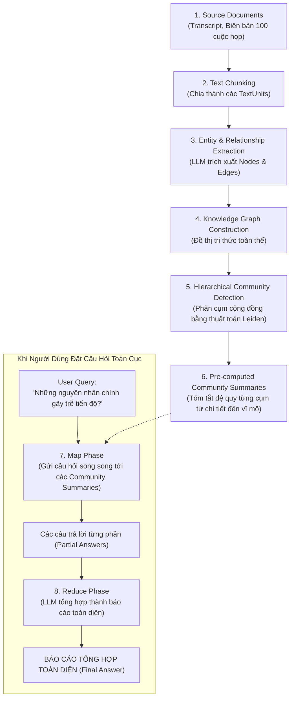
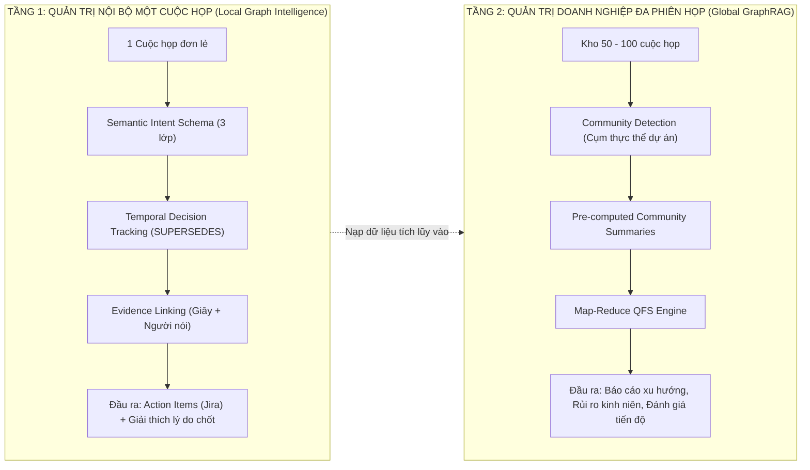

# Nghiên Cứu Tham Chiếu: Microsoft GraphRAG Cho Trí Tuệ Cuộc Họp

Tài liệu này tổng hợp và phân tích chuyên sâu công trình nghiên cứu đột phá **"From Local to Global: A Graph RAG Approach to Query-Focused Summarization"** của Darren Edge và các cộng sự tại **Microsoft Research (2024/2025)**, đồng thời đánh giá cơ hội và phương pháp ứng dụng vào hệ thống **Trí Tuệ Cuộc Họp (Meeting Intelligence Assistant)**.

---

## 1. Thông Tin Công Trình & Bài Toán Nghiên Cứu

* **Tác giả:** Darren Edge, Ha Trinh, Newman Cheng, Joshua Bradley, Alex Chao, Apurva Mody, Steven Truitt, Jonathan Larson (Microsoft Research).
* **Công bố:** Bản v1 (Tháng 4/2024), Bản v2 (Tháng 2/2025).
* **Nguồn tài liệu:** [arXiv:2404.16130](https://arxiv.org/abs/2404.16130) · [Microsoft Research Publication](https://www.microsoft.com/en-us/research/publication/from-local-to-global-a-graph-rag-approach-to-query-focused-summarization/)

### Động lực bài toán
Tác giả chỉ ra hai hạn chế lớn của các hướng tiếp cận AI hiện nay:
1. **Traditional Vector RAG (RAG truyền thống):** Rất giỏi truy xuất các đoạn văn bản cục bộ dựa trên từ khóa tương đồng, nhưng **hoàn toàn thất bại** khi gặp các câu hỏi tổng hợp vĩ mô (*Query-Focused Summarization — QFS*) đòi hỏi phải kết nối các chủ đề và mối quan hệ phân bố rải rác trên toàn bộ tập dữ liệu lớn.
2. **QFS truyền thống:** Có thể tóm tắt nhiều tài liệu, nhưng không thể mở rộng quy mô (*scalability*) khi tập văn bản lên tới hàng triệu token hoặc hàng trăm cuộc họp.

### So sánh câu hỏi trong ngữ cảnh kho 100 cuộc họp dự án:

| Câu hỏi của người dùng | Bản chất bài toán | Phương pháp xử lý tối ưu |
| :--- | :--- | :--- |
| *“Trong cuộc họp ngày 10/10, ai nhận nhiệm vụ thiết kế API?”* | Tra cứu sự kiện cục bộ | **Local Retrieval (Vector / Subgraph Search)** |
| *“Những vấn đề nào được thảo luận nhiều nhất trong 100 cuộc họp?”* | Tổng hợp toàn cục | **Global GraphRAG (Community Summaries)** |
| *“Vì sao quyết định sử dụng PostgreSQL được đưa ra, và nó thay đổi thế nào?”* | Truy vết nhân quả lịch sử | **Temporal Graph Traversal (`SUPERSEDES`)** |
| *“Những trở ngại kỹ thuật nào thường xuyên làm chậm tiến độ dự án?”* | Nhận diện mẫu rủi ro vĩ mô | **Global GraphRAG (Map-Reduce)** |

---

## 2. Kiến Trúc & Quy Trình Hoạt Động Của GraphRAG

Điểm cốt lõi của Microsoft GraphRAG là **xây dựng chỉ mục đồ thị tri thức phân cấp và tóm tắt cộng đồng trước khi nhận câu hỏi**, sau đó dùng cơ chế Map-Reduce để tổng hợp câu trả lời:

### Chi tiết các bước kỹ thuật:
* **Bước 1 — Xây dựng Knowledge Graph:** Dùng LLM trích xuất thực thể (*Entities: Person, Tech, Project*) và mối quan hệ (*Relationships: PROPOSES, OPPOSES, DECIDED*).
* **Bước 2 — Phân cụm cộng đồng (Leiden Algorithm):** Nhóm các thực thể có liên kết chặt chẽ thành các cộng đồng tri thức ở nhiều cấp bậc phân cấp (Cấp 0: toàn cục; Cấp 1: phân hệ lớn; Cấp 2: module chi tiết).
* **Bước 3 — Tạo Community Summaries:** Mỗi cộng đồng được tóm tắt trước bằng LLM để tạo ra một bản báo cáo cô đọng về chủ đề của nhóm đó.
* **Bước 4 — Map-Reduce Querying:** Khi có câu hỏi vĩ mô, hệ thống thực hiện pha Map (chấm điểm và tóm tắt theo từng cộng đồng) và pha Reduce (tổng hợp thành câu trả lời cuối cùng).

---

## 3. Phân Biệt: Local Search vs. Global Search vs. DRIFT Search

Microsoft GraphRAG định nghĩa rõ các chiến lược truy vấn tùy theo phạm vi câu hỏi:

| Cơ chế tìm kiếm | Phạm vi dữ liệu | Cách thức hoạt động | Trường hợp sử dụng tối ưu |
| :--- | :--- | :--- | :--- |
| **Local Search** | Cục bộ / Thực thể cụ thể | Kết hợp thực thể, các quan hệ lân cận trong bán kính 1–2 hop và các đoạn văn bản nguồn (*TextUnits*). | Trả lời về một nhiệm vụ, một con người, hoặc một cuộc họp cụ thể. |
| **Global Search** | Toàn bộ kho tài liệu (*Whole Corpus*) | Sử dụng các bản tóm tắt cộng đồng (*Community Summaries*) qua cơ chế Map-Reduce. | Trả lời câu hỏi tổng kết quý, phân tích xu hướng và rủi ro dự án. |
| **DRIFT Search** | Kết hợp phân cấp & câu hỏi phụ | Mở rộng Local Search bằng cách phân rã câu hỏi lớn thành các câu hỏi con qua cấu trúc cộng đồng. | Điều tra sâu một vấn đề phức tạp trải dài qua nhiều nhóm thực thể. |

---

## 4. Kết Quả Thực Nghiệm & Đóng Góp Học Thuật

Trên tập dữ liệu thử nghiệm quy mô khoảng **một triệu token**, Microsoft Research báo cáo GraphRAG vượt trội hoàn toàn so với Baseline RAG truyền thống ở 2 chỉ số:
1. **Comprehensiveness (Tính toàn diện):** Câu trả lời bao quát được đầy đủ các khía cạnh và góc nhìn khác nhau trên toàn bộ tập dữ liệu.
2. **Diversity (Tính đa dạng):** Câu trả lời đề cập đến nhiều chủ đề con và không bị thiên lệch vào một vài đoạn văn bản có từ khóa trùng lặp.

---

## 5. Các Hạn Chế Cốt Tử Khi Áp Dụng GraphRAG Vào Cuộc Họp

Mặc dù rất xuất sắc cho việc đọc tài liệu tĩnh, GraphRAG của Microsoft gặp **3 rào cản lớn** khi áp dụng vào môi trường họp doanh nghiệp:

| Rào cản của GraphRAG nguyên bản | Rủi ro trong bài toán Cuộc họp | Giải pháp khắc phục trong hệ thống của bạn |
| :--- | :--- | :--- |
| **Mù dòng thời gian (Temporal Blindness)** | GraphRAG xem mọi quan hệ là đồng thời, không biết quyết định B xảy ra sau quyết định A và thay thế A. | Bổ sung **Temporal Decision Tracking** với quan hệ `SUPERSEDES` và mô hình Event Sourcing. |
| **Mất dấu người nói & thẩm quyền** | Bản tóm tắt cộng đồng thường khái quát hóa (*"nhóm đồng thuận"*), làm mất vai trò người giao việc và người chịu trách nhiệm. | Duy trì bắt buộc **Evidence Linking** (`SPOKE`, `Authority check`, `timestamp_ms`). |
| **Chi phí Indexing cực lớn** | Chạy LLM trích xuất từng chunk và tóm tắt đệ quy toàn bộ cộng đồng tốn rất nhiều thời gian và token. | **Phân tầng:** Chỉ chạy Community Detection cho cấp độ nhiều cuộc họp (Cross-meeting); trong một cuộc họp thì dùng Local Subgraph Traversal. |

---

## 6. Ứng Dụng Thực Chiến: Mô Hình Phân Tầng Cho Trí Tuệ Cuộc Họp

Hệ thống của chúng ta kết hợp triết lý của Microsoft GraphRAG thành mô hình **2 tầng thông minh**:

### Ba chức năng vượt trội mà hệ thống đạt được:
1. **Global Meeting Summarization:** Trả lời các câu hỏi cấp giám đốc: *“3 vấn đề kỹ thuật khiến dự án liên tục trễ deadline trong tháng này là gì?”*.
2. **Decision Evolution Tracking:** Truy vết chuỗi thay đổi: Đề xuất $\rightarrow$ Phản biện $\rightarrow$ Chốt $\rightarrow$ Sửa đổi theo thời gian thực.
3. **Graph-based Causal Retrieval:** Trả lời chính xác: *“Tại sao nhóm chọn PostgreSQL thay vì MySQL?”* bằng cách duyệt đường đi đồ thị và dẫn chứng mốc thời gian phát ngôn cụ thể.

---

## 7. Tài Liệu Tham Chiếu Chéo (Cross-References)
* [00-Tong-Quan-Tri-Tue-Cuoc-Hop.md](file:///d:/GENTALENT/00-Tong-Quan-Tri-Tue-Cuoc-Hop.md) — Tổng quan bài toán & mục tiêu Mission 1.
* [04-Meeting-Graph-Construction.md](file:///d:/GENTALENT/04-Meeting-Graph-Construction.md) — Kiến trúc xây dựng đồ thị tri thức cuộc họp lấy bằng chứng làm trọng tâm.
* [05-Graph-Retrieval.md](file:///d:/GENTALENT/05-Graph-Retrieval.md) — Cơ chế truy vấn đồ thị đa bước, Text-to-Cypher và Hybrid RAG.
* [Ref-Meeting-Decision-Tracker-MDT.md](file:///d:/GENTALENT/Ref-Meeting-Decision-Tracker-MDT.md) — Nghiên cứu tham chiếu về DUD & DUR (Tầng vi mô).
* [06-LLM-Agentic-Pipeline-Design.md](file:///d:/GENTALENT/06-LLM-Agentic-Pipeline-Design.md) — Hướng dẫn kiến trúc triển khai Agentic Workflow với LLM API.
